<a id="top"></a>

<picture>
  <source media="(prefers-color-scheme: dark)" srcset="docs/readme/svg/hero-dark.svg">
  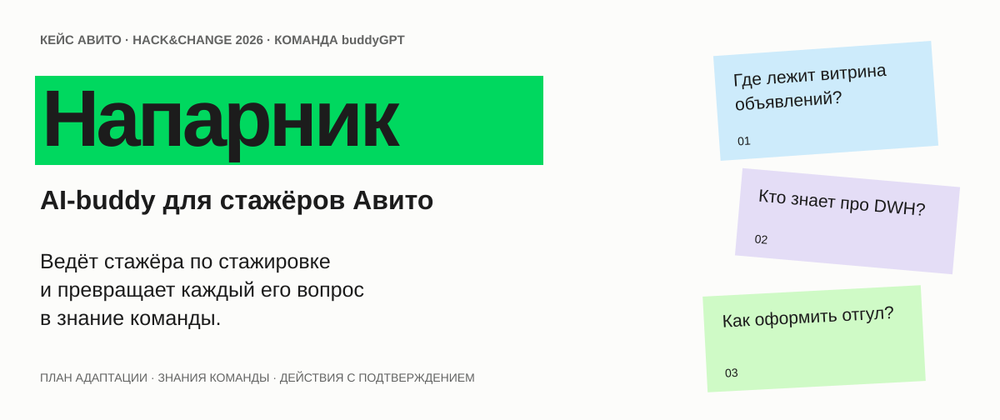
</picture>

**Напарник — ИИ-помощник для адаптации стажёров.** Он показывает, что сделать сегодня, отвечает по знаниям команды и помогает обратиться к нужному человеку. Если требуется отгул или доступ — готовит заявку, которую подтверждает пользователь.

Стажёру проще освоиться. Бадди — наставник стажёра — получает сформулированные вопросы. Эксперт сохраняет ответ для следующих новичков, а руководитель видит прогресс адаптации.

<p>
  <a href="https://naparnik.pavelmernov.ru/"></a>
  <a href="https://disk.yandex.ru/d/xxAoKDQs5wWt0g"></a>
  <a href="https://t.me/buddyAiSuper_bot">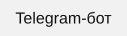</a>
  <br>
  <a href="#start"></a>
  <a href="#docs">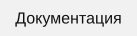</a>
  <a href="docs/02-concept/CJM.md"></a>
</p>

<picture>
  <source media="(prefers-color-scheme: dark)" srcset="docs/readme/svg/stack-dark.svg">
  
</picture>

Прототип по [кейсу Авито](docs/00-case/avito-case.pdf). Все сотрудники и данные синтетические; инструкции в демо помечены как тестовые.

## Навигация

### О продукте

(Выберите раздел, чтобы перейти к нему)

<p>
  <a href="#interface">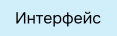</a>
  <a href="#features"></a>
  <a href="#how"></a>
  <a href="#roles"></a>
  <a href="#video"></a>
</p>

### Проверка и запуск

<p>
  <a href="#check"></a>
  <a href="#start">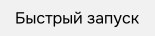</a>
</p>

### Технические материалы

<p>
  <a href="#quality"></a>
  <a href="#docs"></a>
</p>

<a id="почему-появился-напарник"></a>

<picture>
  <source media="(prefers-color-scheme: dark)" srcset="docs/readme/svg/problem-dark.svg">
  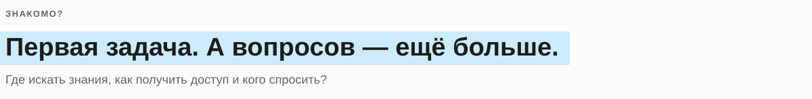
</picture>

В интервью четырём стажёрам было неловко задавать базовые вопросы, а бадди рассказывали о повторяющихся объяснениях и потерянном контексте. [CJM](docs/02-concept/CJM.md) выделяет особенно трудный момент: первая–вторая неделя, когда уже есть задачи, но ещё непонятны инструменты, термины и люди.

| Без Напарника | С Напарником |
|---|---|
| Искать по вики, чатам и записям встреч | Спросить и получить ответ с источником, автором и датой |
| Гадать, кого отвлечь вопросом | Проверить предложенного эксперта и подтвердить отправку |
| Заново объяснять одно и то же | Опубликовать ответ после проверки автора |
| Самому собирать план и порядок оформления доступов | Видеть следующий шаг и подготовленный черновик заявки |

Основание: [4 интервью со стажёрами](docs/01-discovery/interviews/intern-interviews.md), [2 интервью с бадди](docs/01-discovery/interviews/buddy-interviews.md) и [исследование](docs/01-discovery/README.md). Это качественные наблюдения небольшой выборки; экономию времени предстоит измерить в пилоте.

<a id="approach"></a>

<picture>
  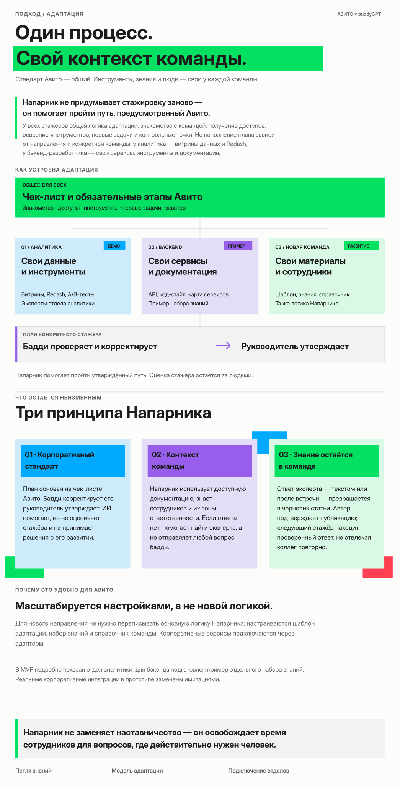
</picture>

[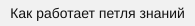](docs/03-requirements/03-PROCESSES.md) [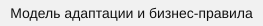](docs/03-requirements/04-BUSINESS-RULES.md) [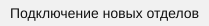](docs/03-requirements/11-INTEGRATION.md)

<a id="interface"></a>

<picture>
  <source media="(prefers-color-scheme: dark)" srcset="docs/readme/svg/interface-dark.svg">
  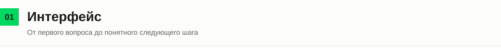
</picture>

Начните с «Моего дня»: здесь стажёр видит ближайшие шаги и встречи. Дальше — план, чат и экраны команды. Все скриншоты сняты в работающем прототипе на демонстрационных данных, без внешнего ключа модели; по клику они открываются в полном размере.

[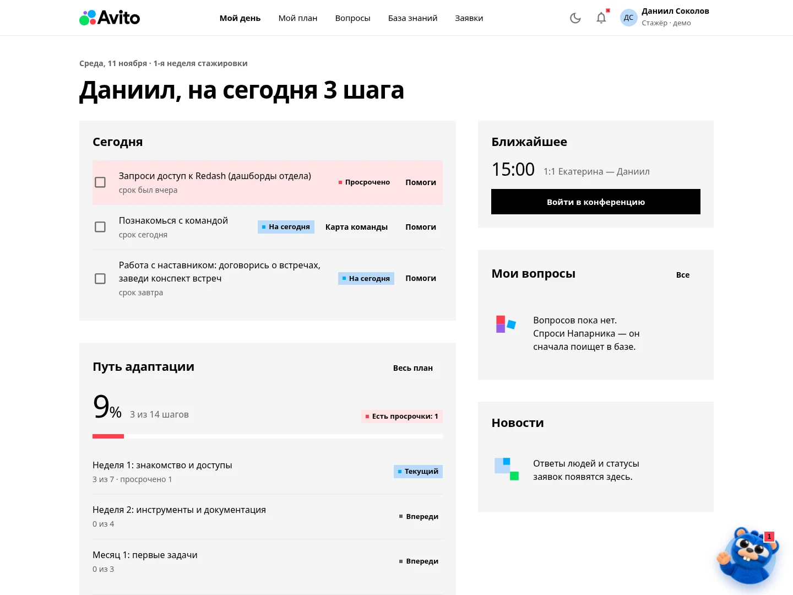](docs/readme/screenshots/my-day.webp)

**«Мой день».** Стажёр сразу видит, с чего начать, где просрочка и что запланировано на сегодня. Маскот открывает чат из любого раздела.

| План адаптации | Ответ по базе знаний |
|---|---|
| [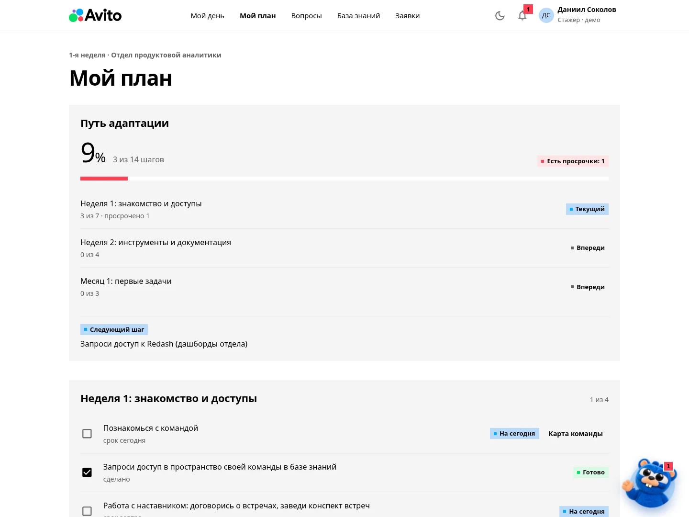](docs/readme/screenshots/plan.webp) | [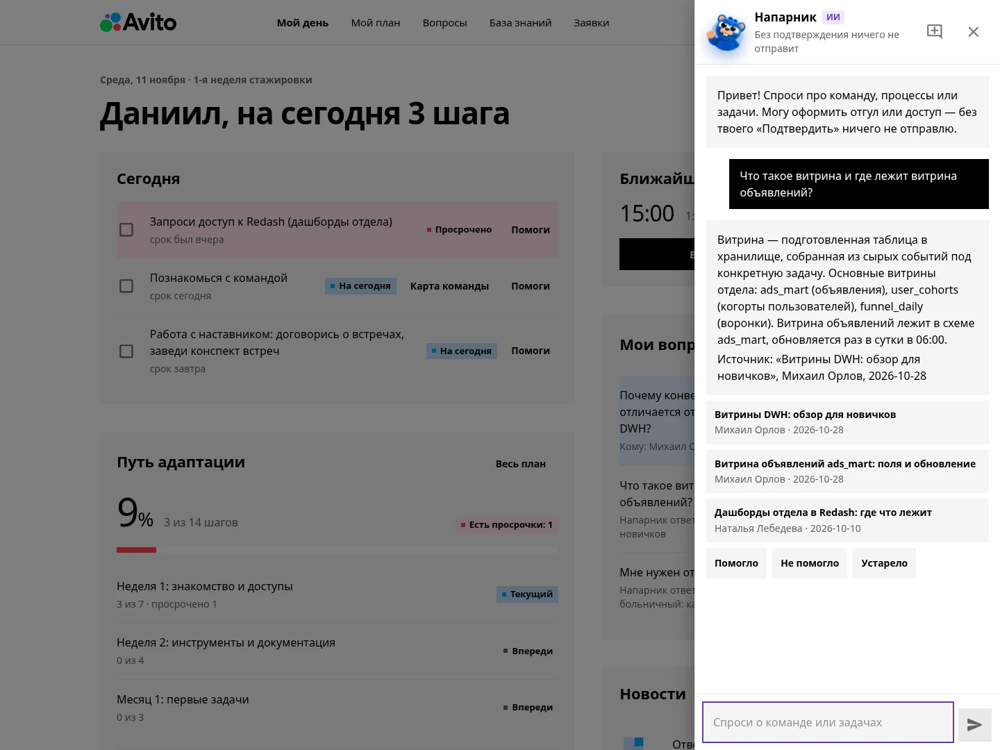](docs/readme/screenshots/chat-source.webp) |
| Этапы, сроки и понятный прогресс. | Источник, автор и дата позволяют проверить ответ. |

| Подбор эксперта | Действие с подтверждением |
|---|---|
| [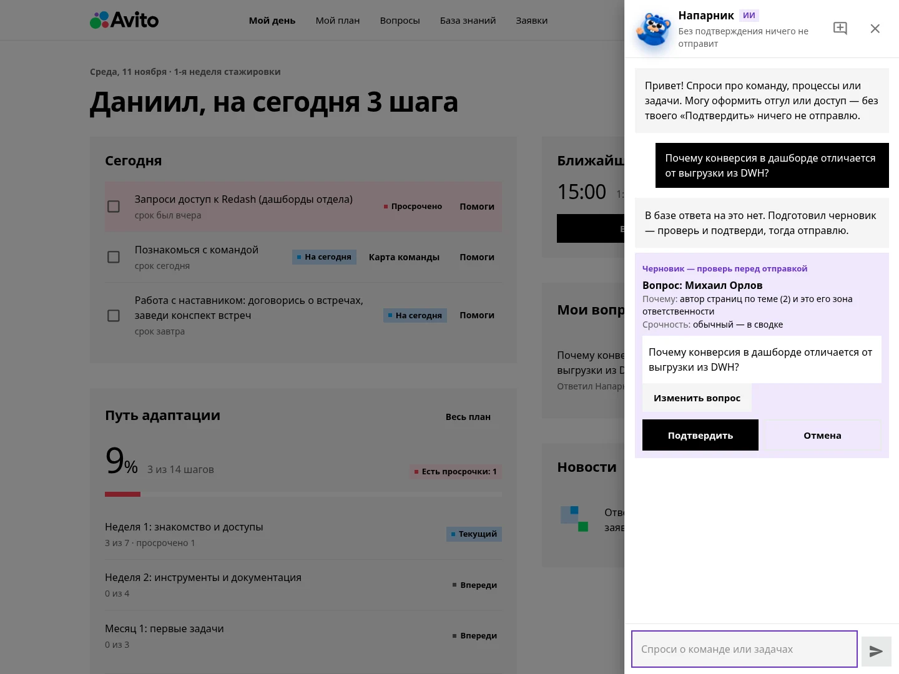](docs/readme/screenshots/expert-draft.webp) | [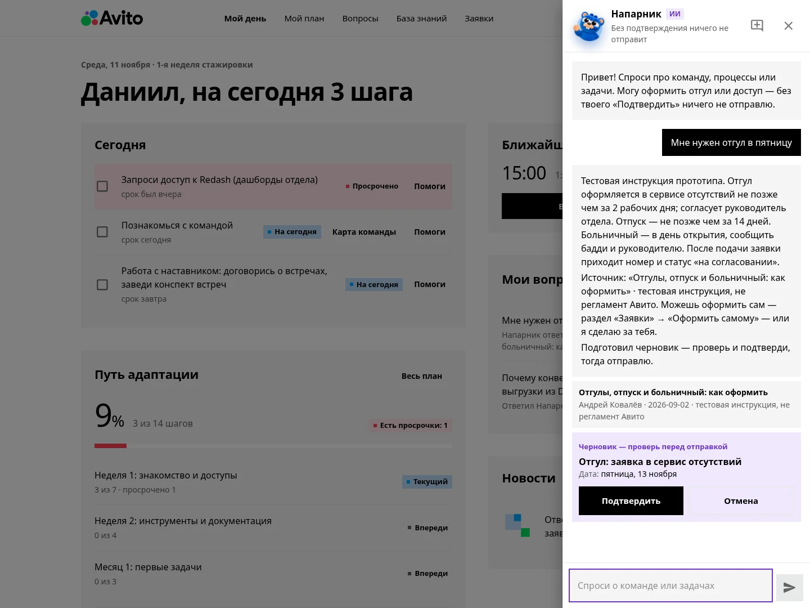](docs/readme/screenshots/absence-draft.webp) |
| Если знания нет, Напарник помогает обратиться к человеку. | Пользователь проверяет черновик перед выполнением. |

| Бадди | Руководитель |
|---|---|
| [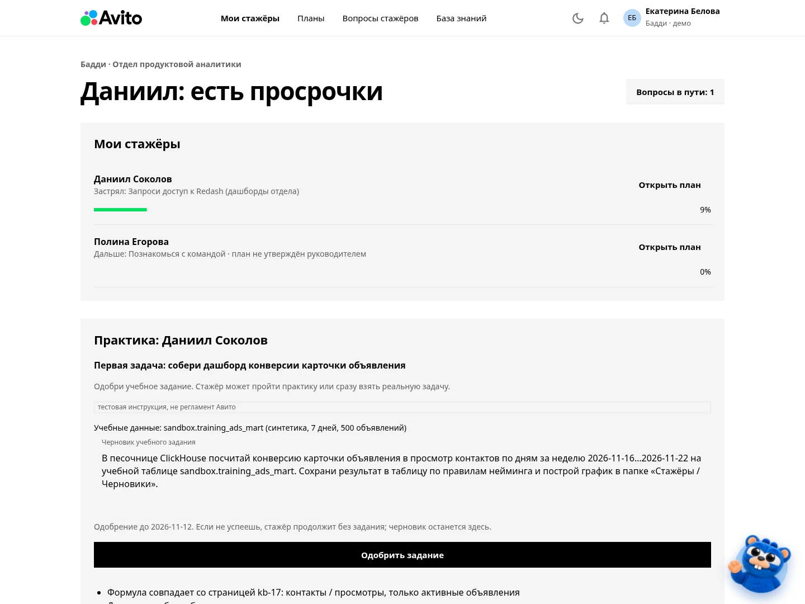](docs/readme/screenshots/buddy.webp) | [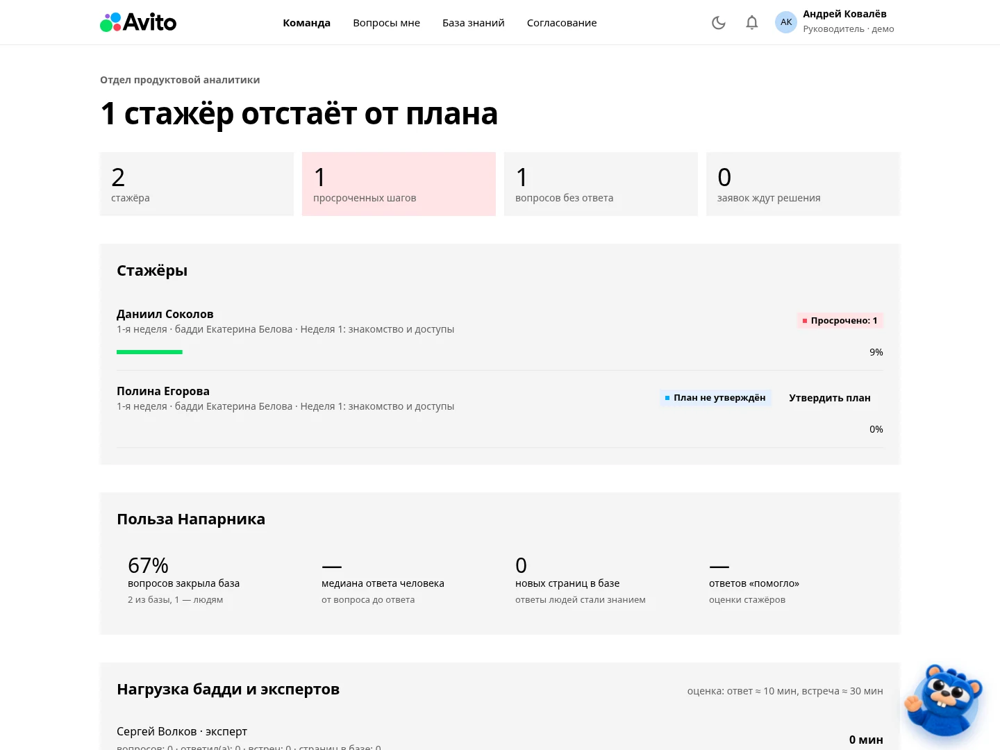](docs/readme/screenshots/lead.webp) |
| Планы подопечных и вопросы, которым нужна помощь. | Обзор адаптации и нагрузки без текстов личных вопросов. |

<a id="напарник-всегда-рядом"></a>

<picture>
  <source media="(prefers-color-scheme: dark)" srcset="docs/readme/svg/mascot-dark.svg">
  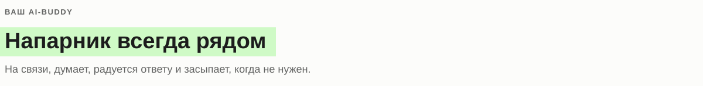
</picture>

Маскот открывает чат из любого раздела и показывает, что происходит. Ниже — настоящие состояния виджета в приложении.

| На связи | Думает | Ответ готов | Дремлет | Спит |
|:---:|:---:|:---:|:---:|:---:|
|  | 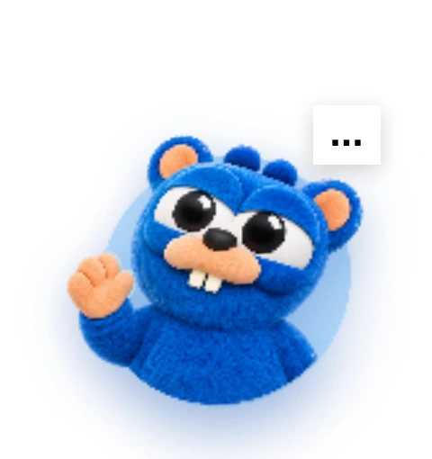 |  |  |  |
| Готов помочь | Запрос к ИИ в работе | Пришёл ответ | Минута без действий | Полторы минуты без действий |

Через минуту без действий он начинает дремать, через полторы — засыпает. Движение, клик или новое событие будят его. Маскота можно свернуть или скрыть на час; анимации учитывают системную настройку уменьшения движения. [Все состояния и переходы →](docs/03-requirements/08-DESIGN.md)

<details>
<summary>Входящие эксперта и тёмная тема</summary>

[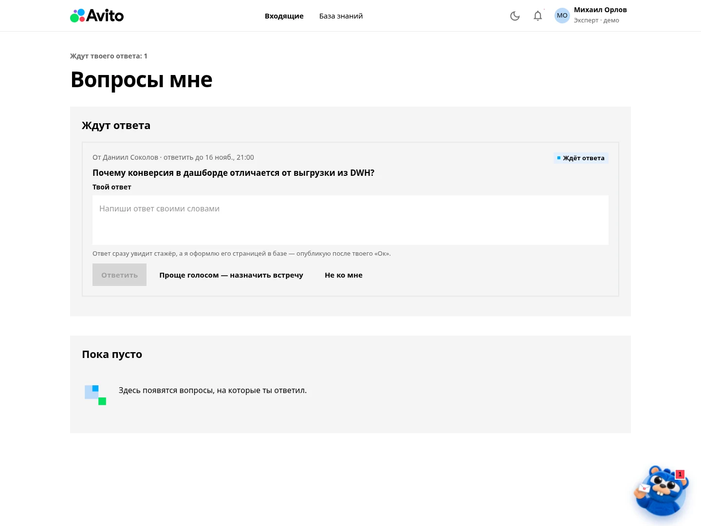](docs/readme/screenshots/expert.webp)

Эксперт отвечает текстом, переадресует вопрос или предлагает встречу; новая статья публикуется после его «Ок».

[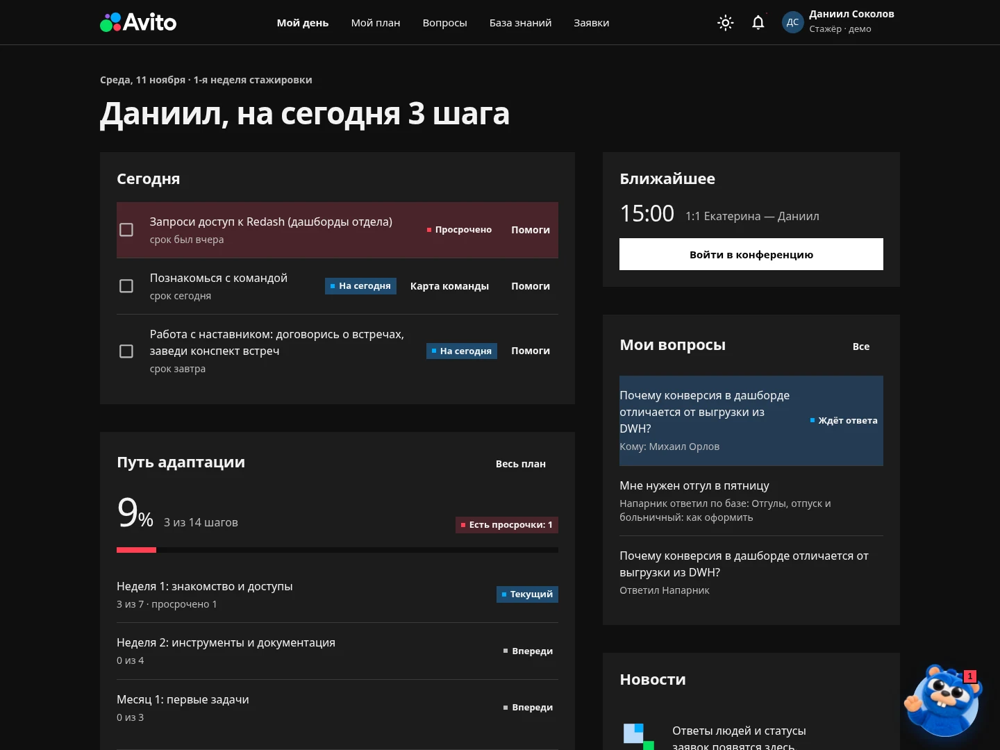](docs/readme/screenshots/my-day-dark.webp)

Светлая и тёмная темы доступны в интерфейсе для всех ролей.

</details>

<a id="features"></a>

<picture>
  <source media="(prefers-color-scheme: dark)" srcset="docs/readme/svg/features-dark.svg">
  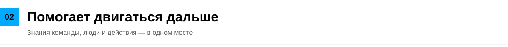
</picture>

Напарник помогает в трёх ситуациях: понять следующий шаг, найти ответ и выполнить действие. Вот что уже работает в прототипе.

| Задача | Что реализовано |
|---|---|
| **Разобраться без лишнего ожидания** | Поиск по доступным знаниям; ответ со ссылкой, автором и датой; оценки «помогло / не помогло / устарело». Если ответа нет — подбор эксперта с объяснением или обращение к бадди. |
| **Сохранить ответ для команды** | Ответ сотрудника → черновик статьи → подтверждение автора → база знаний. Для встреч есть сценарий выжимки из демонстрационного транскрипта с таймкодами. |
| **Понимать следующий шаг** | «Мой день», этапы и прогресс; черновик плана правит бадди, утверждает руководитель. Уведомления о сроках и простое. |
| **Оформить действие** | Отгул и доступ: инструкция или помощь с оформлением; черновик → подтверждение → вызов сервиса → квитанция. Повтор не создаёт вторую заявку. |
| **Оставаться в контексте** | Вопросы и встречи, карта команды, уведомления в вебе и Telegram при подключённом боте; права зависят от роли и доступного пространства. |
| **Продолжить при сбое модели** | Упрощённый режим на правилах использует те же инструменты, проверки и черновики. UI показывает ожидание, ошибку и возможность повтора. |

**Дополнительно к основному пути кейса:** практика перед первой задачей с проверкой критериев, глоссарий команды, экраны бадди/эксперта/руководителя, поддержка базы знаний, Telegram, MCP и feature flags. Статус всех SC-01…SC-36 и незавершённые части — в [матрице реализации](docs/STATUS.md).

<a id="how"></a>

<picture>
  <source media="(prefers-color-scheme: dark)" srcset="docs/readme/svg/how-dark.svg">
  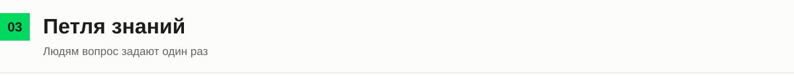
</picture>

<picture>
  <source media="(prefers-color-scheme: dark)" srcset="docs/readme/diagrams/knowledge-loop-dark.svg">
  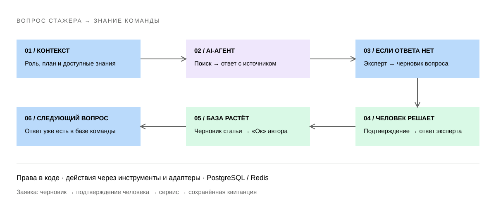
</picture>

**Петля знаний:** если ответа нет в базе, Напарник помогает обратиться к эксперту или бадди. Ответ становится статьёй после подтверждения автора, и следующий стажёр получает его из базы.

React отправляет запрос в Go API. Агент получает контекст пользователя и выбирает инструмент; **права и допустимость действия проверяет код**. Чтение выполняется сразу, действия с внешним эффектом сначала становятся черновиком. Подтверждённая операция сохраняет результат и квитанцию.

Корпоративные вики, трекер, календарь, ВКС и сервисы заявок в демо заменены **имитациями**. Интерфейсы адаптеров позволяют подключить реальные системы; для сервиса отсутствий уже есть REST-клиент. Поиск и подбор эксперта лексические, без эмбеддингов.

[](docs/spec/00-overview.md)

<a id="roles"></a>

<picture>
  <source media="(prefers-color-scheme: dark)" srcset="docs/readme/svg/roles-dark.svg">
  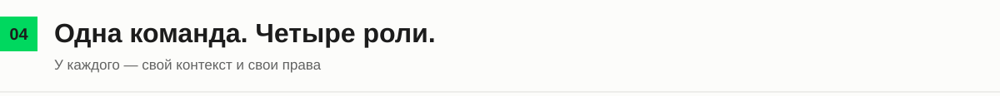
</picture>

Стажёр — основной пользователь. Остальные участники подключаются там, где нужны их знания, помощь или решение.

| Роль | Проблема | Что даёт Напарник | Ожидаемая польза |
|---|---|---|---|
| **Стажёр** | Неясно, что делать и кого спросить | План, знания, эксперт и помощь с заявками | Меньше времени на разблокировку |
| **Бадди** | Повторяющиеся вопросы и ручной контроль | Сформулированные вопросы, прогресс и сигналы простоя | Больше времени на содержательное наставничество |
| **Эксперт** | Ответы теряются в личных переписках | Ответ или встреча → проверенная статья с авторством | Меньше повторных объяснений |
| **Руководитель** | Адаптацию приходится выяснять вручную | Прогресс, просрочки, заявки и метрики нагрузки | Видимость проблем и вклада команды |

Это гипотезы эффекта, а не результаты внедрения. Главная продуктовая метрика — время до первой полезной задачи.

[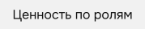](docs/03-requirements/10-ROLE-VALUE.md) [](docs/03-requirements/09-METRICS.md)

<a id="video"></a>
<a href="https://disk.yandex.ru/d/xxAoKDQs5wWt0g">
<picture>
  <source media="(prefers-color-scheme: dark)" srcset="docs/readme/svg/video-dark.svg">
  
</picture>
</a>


<a href="https://disk.yandex.ru/d/xxAoKDQs5wWt0g"></a>

**Продуктовая презентация:** по [статусу материалов](docs/STATUS.md) финальный PDF подготовлен командой вне репозитория. Утверждённой копии и публичной ссылки в GitHub пока нет.

<a id="start"></a>

<picture>
  <source media="(prefers-color-scheme: dark)" srcset="docs/readme/svg/start-dark.svg">
  
</picture>

### Первый запуск — через Docker

Нужны Docker Engine/Desktop и **Docker Compose v2 с поддержкой `env_file.required` (2.24+)**. PostgreSQL 16 и Redis 7 поднимутся автоматически. Внешний ключ модели для демо не нужен.

```bash
git clone https://github.com/worker4556/naparnik.git
cd naparnik
# Необязательно: только если хотите изменить настройки; существующий .env не затирайте
cp .env.example .env
docker compose up --build -d
docker compose ps
```

| Сервис | Docker | Локальная разработка |
|---|---|---|
| Интерфейс | **http://localhost:3001** | **http://127.0.0.1:5173** |
| API | http://localhost:8082 | http://127.0.0.1:8080 |
| Проверка API | `curl http://localhost:8082/api/naparnik` | `curl http://127.0.0.1:8080/api/naparnik` |

Дождитесь готовности контейнеров перед открытием интерфейса. В Docker nginx обслуживает UI и проксирует `/api` в backend. PostgreSQL и Redis не публикуют порты на хост.

```bash
docker compose logs -f backend   # журнал запуска и ошибок
docker compose down              # остановить, сохранив данные
docker compose up -d             # запустить снова
```

**Полный сброс демонстрации:** `docker compose down -v`, затем `docker compose up -d`. Команда с `-v` удаляет PostgreSQL и Redis, включая заявки, статьи, историю и привязки Telegram. Изменённые фикстуры применяются к новой базе, а не поверх сохранённой.

### Для разработки — локальный запуск

Нужны **Go 1.27.3** (версия в `backend/go.mod`) и **Node.js 22.12+ / npm** (Docker и CI используют Node 22). Два терминала из корня проекта:

```bash
# Терминал 1 — API; пустые адреса включают временное хранилище в памяти
cd backend
DATABASE_URL= REDIS_URL= go run ./cmd/server
```

```bash
# Терминал 2 — React, Vite проксирует /api на 127.0.0.1:8080
cd frontend
npm ci
npm run dev
```

Без PostgreSQL и Redis локальное демо работает, но состояние теряется после остановки backend. Для постоянного хранения задайте в корневом `.env` адреса **своих запущенных** PostgreSQL 16 и Redis 7 (`DATABASE_URL`, `REDIS_URL`) и запускайте `go run ./cmd/server` без пустых переопределений. Backend читает `.env` из своей папки или корня; Vite ожидает API на `8080`.

[](docs/PERSISTENCE.md)

<details>
<summary>Подключить модель и Telegram · разобраться с ошибками запуска</summary>

**Без ключей:** выбирается заглушка, внешние запросы к модели не нужны. Она демонстрирует основные ветки, но не заменяет свободный диалог с LLM.

**DeepSeek:** в `.env` задайте `LLM_PROVIDER=deepseek`, `DEEPSEEK_API_KEY=ваш_ключ`, `LLM_MODEL=deepseek-chat`; оставьте `LLM_API_KEY` пустым. API по умолчанию — `https://api.deepseek.com`, иной совместимый адрес задаётся `LLM_BASE_URL`.

**Anthropic / Claude:** `LLM_PROVIDER=anthropic`, `LLM_API_KEY=ваш_ключ`, `LLM_MODEL` — доступная вашему аккаунту модель. Значение по умолчанию в коде — `claude-opus-5-5`; доступность конкретной модели проверяйте у провайдера. Для имитации сбоя: `LLM_MODE=stub_error` / `stub_timeout` / `stub_slow`; таймаут — `LLM_TIMEOUT_SEC` (по умолчанию 30).

После изменения `.env` пересоздайте backend: `docker compose up -d --force-recreate backend`; для локального режима перезапустите процесс. Ключи хранятся только в `.env`, не в Git и не в браузере.

**Telegram:** `TG_BOT_TOKEN`, `TG_MODE=live`, `WEB_URL=http://localhost:3001` для Docker (`3000` из `.env.example` здесь не подходит). В профиле получите одноразовый код и отправьте боту `/start КОД`. Без токена — режим журнала. `NOTIFY_IGNORE_HOURS=true` в Compose доставляет сразу для демонстрации; `false` включает рабочие часы и сводки. [Правила уведомлений →](docs/spec/07-notifications.md)

**Если не запускается:** проверьте `docker compose ps` и логи; освободите занятые `3001`/`8082` или `5173`/`8080` для выбранного режима. Ошибка соединения с заданными PostgreSQL/Redis останавливает запуск: убедитесь, что адреса доступны. Для ошибки загрузки зависимостей проверьте сеть и сертификаты; при `no space left on device` освободите диск. Compose использует `CODEX_PROXY_CERT`, если он задан, иначе существующий пустой `docker/no-proxy-ca.pem`.

Все параметры и имитации сбоев сервисов (`MOCK_FAIL=absence,access`) — в [.env.example](.env.example). Настоящий сервис отсутствий — `ABSENCE_SERVICE_URL` и `ABSENCE_SERVICE_TOKEN`, [контракт адаптера](docs/spec/09-adapters.md).

</details>

<a id="check"></a>

<picture>
  <source media="(prefers-color-scheme: dark)" srcset="docs/readme/svg/check-dark.svg">
  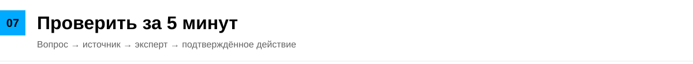
</picture>

Вход в прототип заменён переключателем учёток **в правом верхнем углу**. Пароли не нужны. Демонстрационная дата — **11 ноября 2026**, третий день стажировки Даниила; она берётся из фикстур, её можно изменить через `DEMO_TODAY`.

1. **Даниил Соколов (`intern.sokolov`).** Откройте «Мой день» и «Мой план»: шаги, просрочка и этапы адаптации.
2. **Ответ с источником.** Нажмите маскота и спросите: «Что такое витрина и где лежит витрина объявлений?» Ожидается ответ по базе с карточкой источника, автором и датой.
3. **Нет ответа в базе.** «Почему конверсия в дашборде отличается от выгрузки из DWH?» → при необходимости «да, подготовь вопрос» → проверьте адресата Михаила Орлова → «Подтвердить».
4. **Смена роли.** Выберите `expert.orlov` → «Входящие» → ответьте на отправленный вопрос → «Проверить» в блоке черновиков → «Ок, опубликовать». Под `intern.egorova` спросите о расхождении конверсии с DWH: теперь доступен ответ из новой статьи.
5. **Действие.** Вернитесь к Даниилу: «Мне нужен отгул в пятницу». С живой моделью выберите «Сделай за меня»; заглушка сразу готовит черновик. До «Подтвердить» заявка не отправлена; после — видна квитанция `ABS-…`. Под `lead.kovalev` откройте «Согласование» и примите решение; вернитесь к стажёру, проверьте статус.

При повторном прохождении уже оформленный отгул не дублируется — выберите другую дату. Внешняя модель может задавать уточняющие вопросы; подписи и длина ответа отличаются от заглушки.

**Полный цикл плана:** `buddy.belova` → «Проверить черновик» → правки и комментарий → «Сохранить правки» → «Отправить на согласование». `lead.kovalev` → карточка плана → «Вернуть бадди» с замечанием или «Утвердить план». Для действующего плана бадди открывает «Редакции и согласование» → «Изменить действующий план»: стажёр продолжает работать по прежней редакции до утверждения. Выполненные шаги сохраняются, история применённых редакций видна в «Моём плане».

[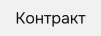](docs/spec/10-plan-lifecycle.md)

**Приёмка перед сдачей:** отдельный Docker-стенд и браузерный сценарий с перезапуском PostgreSQL/Redis/backend, сбоем модели и безопасным повтором заявки.

[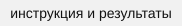](docs/ACCEPTANCE.md)

<details>
<summary>Кого выбрать в переключателе: все тестовые учётки</summary>

| Учётка | Кто | Роль |
|---|---|---|
| `intern.sokolov` | Даниил Соколов | Стажёр-аналитик, основной сценарий |
| `intern.egorova` | Полина Егорова | Стажёр, тексты вопросов скрыты от бадди |
| `buddy.belova` | Екатерина Белова | Бадди и эксперт |
| `expert.orlov` | Михаил Орлов | Эксперт по витринам DWH |
| `expert.smirnova` | Ольга Смирнова | Эксперт по A/B-платформе |
| `expert.lebedeva` | Наталья Лебедева | Эксперт по дашбордам |
| `lead.kovalev` | Андрей Ковалёв | Руководитель отдела |
| `director.volkov` | Сергей Волков | Директор по аналитике; вопросы по его темам идут через бадди |

В API учётка передаётся заголовком `X-User: intern.sokolov`. Это имитация входа для демонстрации, не промышленная аутентификация. Стартовые экраны зависят от роли: «Мой день», «Мои стажёры», «Входящие», «Команда».

</details>

<details>
<summary>Дополнительные проверки: доступы, практика, встречи, права и сохранение</summary>

- **Доступы:** «Нет доступа к витринам, как туда попасть?» → правила по неделе стажировки → «Сделай за меня» → черновик → подтверждение → `ACC-…`. В «Согласовании» руководитель выдаёт доступ, стажёр отмечает шаг выполненным. Альтернатива — «Заявки» → «Оформить самому».
- **Встреча:** эксперт выбирает «Проще голосом», слот и сценарий записи; демонстрационный транскрипт превращается в черновик ответа. Ссылку на запись видят только участники. Вариант без записи оставляет возможность ответить текстом или открыть вопрос владельцу базы.
- **Практика:** бадди одобряет учебное задание; стажёр проходит термины и задание, получает обратную связь по критериям. Не более трёх попыток; после неудач можно подготовить и подтвердить вопрос бадди.
- **Права:** руководитель видит прогресс, а не тексты личных вопросов. Закрытые данные не раскрываются; конфиденциальная страница даётся ссылкой без передачи её текста внешней модели.
- **Передача базы знаний:** под `lead.kovalev` в «Поддержке базы знаний» передайте базу Ольге Смирновой, затем Екатерине Беловой. Переключите учётку на `buddy.belova`: в колокольчике появится уведомление о назначении, нажатие откроет поддержку базы. Просмотр карточки Екатерины без смены учётки её уведомления не показывает.
- **Сбой:** `LLM_MODE=stub_error` проверяет упрощённый режим; `MOCK_FAIL=absence` — сохранение черновика при ошибке сервиса.
- **Хранение:** после подтверждённой заявки выполните `docker compose restart backend` и обновите страницу — квитанция остаётся при PostgreSQL. Контекст разговора модели после перезапуска начинается заново.

Подробные условия, ожидаемые ветки и ограничения: [тестовые персоны и 36 сценариев](docs/03-requirements/06-TEST-PERSONAS.md), [статус каждого сценария](docs/STATUS.md), [данные для проверки](docs/04-mock-data/README.md).

</details>

<a id="quality"></a>

<picture>
  <source media="(prefers-color-scheme: dark)" srcset="docs/readme/svg/quality-dark.svg">
  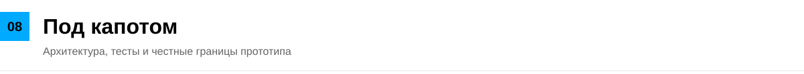
</picture>

| Слой | Реализация |
|---|---|
| Интерфейс | React 19, TypeScript, MUI, Vite; структура FSD; Zod проверяет ответы API; SSE и резервный опрос |
| Backend | Go 1.27.3, HTTP API, агент, инструменты с проверкой прав, stdio MCP |
| Модели | Anthropic SDK, OpenAI-совместимый клиент для DeepSeek, заглушка и запасной режим на правилах |
| Состояние | PostgreSQL 16: версионированный JSONB-документ с транзакциями; Redis 7: кэш, коды Telegram, лимиты и блокировки |
| Доставка и наблюдаемость | Docker Compose, GitHub Actions, журнал событий; опциональная выгрузка в HTTP-коллектор или JSONL; feature flags |

### Что показали проверки

Ниже — **сохранённые отчёты репозитория**, а не обещание результата нового запуска или качества на любых вопросах.

| Проверка | Результат | Основание |
|---|---|---|
| Backend, покрытие операторов | 94.1% | [Отчёт Go](docs/coverage/coverage.txt) |
| Frontend, строки / ветви | 94.01% / 84.15% | [coverage-summary.json](frontend/coverage/coverage-summary.json) |
| Frontend, функции / операторы | 87.93% / 90.56% | Тот же сохранённый отчёт |
| 43 оценочных вопроса, заглушка | **38/43**, 12 ноября 2026 | [stub.md](docs/evals/stub.md) |
| Те же вопросы, DeepSeek | **43/43**, 13 ноября 2026 | [live.md](docs/evals/live.md) |
| Docker и браузерная приёмка | Пройдена 15 ноября 2026: роли, планы, цикл знаний, перезапуск и сбои | [Воспроизведение и отчёт](docs/ACCEPTANCE.md) |
| Сценарии продукта | SC-01…SC-36 отмечены реализованными | [Матрица статуса и ограничения](docs/STATUS.md) |

Оценочный набор проверяет ветку, источник, адресата и права через настоящего агента; запуск заглушки не обращается во внешний API. Корпус небольшой и синтетический, он не доказывает эффект пилота. [CI](.github/workflows/tests.yml) запускает сборку, тесты, `go vet`, race-проверку с PostgreSQL, порог покрытия 80%, сборку Docker и сквозную приёмку собранного приложения; здесь не заявляется текущий статус удалённого CI.

```bash
# Из корня проекта
npm --prefix frontend ci
npm --prefix frontend run build
npm --prefix frontend run test:coverage
./scripts/coverage.sh

# Из backend; без внешнего ключа
cd backend
go test ./...
go run ./cmd/evals -mode stub
# С настроенной внешней моделью в .env
go run ./cmd/evals -mode live
```

`go test` и команды `go run` выше выполняются из `backend`. PostgreSQL-интеграционные тесты требуют `TEST_DATABASE_URL` доступной тестовой БД; в CI она поднимается автоматически. [Скрипт покрытия](scripts/coverage.sh) и [тесты backend](backend/internal) позволяют воспроизвести проверки.

<details>
<summary>Что пока ограничено в прототипе · MCP и CLI</summary>

- Авторизация имитируется переключателем и `X-User`; настоящая корпоративная идентификация не подключена.
- Сервисы и запись/транскрипт встречи синтетические; нет действующего подключения к корпоративным системам Авито, Grafana или Kafka. Для Kafka предусмотрен внешний HTTP-коллектор, а не прямой Kafka-клиент.
- Поиск без эмбеддингов: новый вопрос вне словаря может уйти бадди. Нет доказанных результатов пилота или измеренной экономии времени.
- PostgreSQL хранит состояние одной команды в одном JSONB-документе. Это схема прототипа; контекст сессии LLM остаётся в памяти, хотя история веб-чата и бизнес-объекты сохраняются.
- Вебхук сервиса отсутствий не реализован. Для отсутствий предусмотрен опрос статуса; сервис доступов остаётся имитацией. Офлайн-режима нет.
- **MCP:** `cd backend && NAPARNIK_USER=intern.sokolov go run ./cmd/mcp`; stdio, тот же набор прав, действия становятся подтверждаемыми черновиками в Напарнике. [Подключение](docs/spec/08-mcp.md).
- **CLI агента:** из `backend` выполните `go run ./cmd/buddy -user intern.sokolov "Мне нужен отгул в пятницу"`.
- **HTTP API, адаптеры и feature flags:** [спецификация инструментов](docs/spec/05-tools-api.md), [интеграции](docs/spec/09-adapters.md), [.env.example](.env.example).

</details>

<a id="docs"></a>

<picture>
  <source media="(prefers-color-scheme: dark)" srcset="docs/readme/svg/docs-dark.svg">
  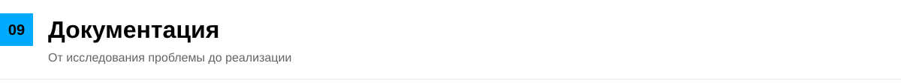
</picture>

| Раздел | Материалы |
|---|---|
| Кейс и критерии | [](docs/00-case/avito-case.pdf) [](docs/00-case/acceptance-criteria.md) [](docs/CASE-CHECK.md) |
| Исследование | [](docs/01-discovery/README.md) |
| Концепция | [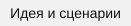](docs/02-concept/IDEA-AND-FLOWS.md) [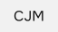](docs/02-concept/CJM.md) [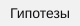](docs/02-concept/HYPOTHESES.md) |
| Требования | [](docs/03-requirements/01-PRD.md) [](docs/03-requirements/02-ROLES.md) [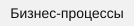](docs/03-requirements/03-PROCESSES.md) [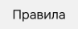](docs/03-requirements/04-BUSINESS-RULES.md) |
| Дизайн и ценность | [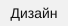](docs/03-requirements/08-DESIGN.md) [](docs/03-requirements/10-ROLE-VALUE.md) |
| Архитектура и AI | [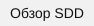](docs/spec/00-overview.md) [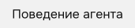](docs/spec/04-agent-behavior.md) [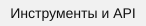](docs/spec/05-tools-api.md) |
| Данные и интеграции | [](docs/04-mock-data/README.md) [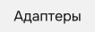](docs/spec/09-adapters.md) [](docs/PERSISTENCE.md) |
| Метрики | [](docs/03-requirements/09-METRICS.md) [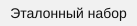](docs/04-mock-data/evals.json) |
| Статус и устойчивость | [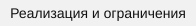](docs/STATUS.md) [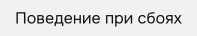](docs/03-requirements/12-RESILIENCE.md) |

[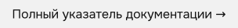](docs/README.md) [](#top)
