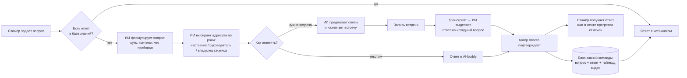

# AI-buddy: брейншторм продукта

> **Hack&Change 2026 · кейс Авито «AI-buddy: ИИ-наставник для стажёров»**
> Стадия: discovery до интервью. Документ опирается только на текст кейса и desk research по открытым источникам. Результаты интервью: [стажёры](./interviews/intern-interviews.md), [бадди](./interviews/buddy-interviews.md).

**Статус гипотез:** 🟢 подтверждено источниками · 🟡 частично / косвенно · ⚪ не проверено, нужно интервью

---

## Содержание
1. [Задача и рамки кейса](#1-задача-и-рамки-кейса)
2. [Что говорят стажёры: desk research](#2-что-говорят-стажёры-desk-research)
3. [Как оценивают решение и что из этого следует](#3-как-оценивают-решение-и-что-из-этого-следует)
4. [Брейншторм: чем отличаться от других команд](#4-брейншторм-чем-отличаться-от-других-команд)
5. [Кандидаты в сценарии](#5-кандидаты-в-сценарии)
6. [ИИ: спрос, риски, доверие](#6-ии-спрос-риски-доверие)
7. [Метрики пользы](#7-метрики-пользы)
8. [Гипотезы для интервью](#8-гипотезы-для-интервью)
9. [Открытые вопросы](#9-открытые-вопросы)
10. [Источники](#10-источники)

---

## 1. Задача и рамки кейса

**Цель:** прототип ИИ-помощника, который помогает стажёру освоиться в команде. Помощник объясняет процессы и инструменты, отвечает на вопросы, ведёт по этапам адаптации и выполняет действия через корпоративные сервисы. При этом он **не заменяет живого общения с наставником**.

**Бизнес-контекст из кейса:**
- наставник тратит **40–48 ч** на стажёра за 6-месячную программу и **55–65 ч** за 9-месячную (ориентировочная оценка Авито);
- AI-buddy должен сокращать рутинные обращения и организационные действия, а не содержательную работу наставника.

**Пример из кейса:** стажёру нужен отгул, он не знает порядка и стесняется отвлекать руководителя. Помощник объясняет процедуру, готовит запрос через сервис и показывает результат.

**Что обязательно** (раздел «Постановка задачи»):
- [ ] путь стажёра в первые недели и выбор 3–5 сценариев (или одного глубокого) на основе [чек-листа Авито](https://docs.google.com/spreadsheets/d/1qKFqOzfSZ2jEz57jBSmq7rukDXi_tRfWohgemViceV0/edit?usp=sharing);
- [ ] ответы о команде и инструментах с учётом контекста;
- [ ] хотя бы одно **действие** через сервис или его имитацию: сервис возвращает результат, помощник его показывает и сохраняет;
- [ ] этапы адаптации, статусы задач, следующие шаги;
- [ ] обоснование архитектуры, прав и интеграций;
- [ ] метрики пользы и способ проверить эффект.

**Ограничения:**
- данные только синтетические;
- тестовые инструкции нельзя выдавать за регламенты Авито;
- помощник учитывает права пользователя;
- не трогаем чувствительные ПДн и финансы;
- покрытие тестами больше 80%, есть SDD-спецификации;
- UI отвечает быстрее 1 с, а запросы к LLM не блокируют интерфейс.

**Доступные сервисы:** отсутствия, командировки, найм, увольнения, согласия, бенефиты, чек-лист новичка.

**Инфраструктура:** авторизация, ролевая модель, ИИ-агенты, MCP, ИИ-крон, feature flags.

**Стек:** Go / Python-Flask, PostgreSQL, Redis, React + TypeScript (TanStack, Zustand, Zod).

---

## 2. Что говорят стажёры: desk research

**Выборка:** 70 публичных отзывов и постов по 13 компаниям РФ.
- По компаниям: Сбер, Касперский, МТС, Яндекс, ВТБ, Альфа-Банк, Ozon, Т-Банк, Газпромбанк, RWB, ЮMoney, VK, Ламода.
- По источникам: 58 коротких отзывов с [dreamjob.ru](https://dreamjob.ru) и 12 длинных постов на Хабре, vc.ru и в Т—Ж.

> ⚠️ **Ограничения выборки:**
> - dreamjob модерирует отзывы;
> - IT-роль явно указана только в 14 записях;
> - комментарии Хабра, Reddit и Telegram оказались недоступны;
> - **отзывов стажёров Авито не нашлось**.
>
> Цитаты получены автоматическим извлечением, перед использованием в презентации их нужно сверить с первоисточником.

### 2.1 Частота болей (упоминаний из 70)

| Боль | Упоминаний | Компаний |
|---|---:|---:|
| Организационный хаос стажировки, непонятный выход в штат | 20 | 9 |
| Непонятные процессы, стыки отделов, бюрократия | 12 | 8 |
| Перегрузка в первые дни | 12 | 7 |
| Доступы и окружение (разрешения, ПО, рабочее место) | 11 | 7 |
| Бытовые HR-процессы (ДМС, больничный, документы, оплата) | 10 | 7 |
| Расхождение ожиданий и задач | 7 | 4 |
| Страх отвлекать наставника | 5 | 5 |
| Наставник занят или отсутствует | 5 | 5 |
| «Нечем заняться» | 4 | 2 |
| «Не знаю, кого спросить» | 3 | 3 |
| Устаревшая или разбросанная документация | 3 | 3 |
| Внутренний жаргон | 2 | 2 |
| Использование ИИ | 2 | 2 |

**Важный нюанс.** Частота показывает, о чём стажёры **жалуются публично**, а не что **сильнее всего мешает им в первые дни**.
- В коротком поле «минусы» на dreamjob пишут то, что умещается в одну фразу: «устаревшее ПО», «документооборот».
- Жаргон, страх спрашивать и простой без задач почти целиком описаны в длинных постах. Там страх отвлекать встречается в **4 из 12** текстов, перегрузка тоже в 4.

### 2.2 Голоса стажёров

**Термины и «много всего сразу»**
- «Я постоянно записывал новые термины и затем шел искать их на wiki-страницах или узнавать у коллег». Стажёр, Яндекс Go ([Хабр](https://habr.com/ru/articles/682334/))
- «По началу много всего важного нужно понять и запомнить за короткий срок». Стажёр, Ozon ([dreamjob](https://dreamjob.ru/employers/26029/city-moskva/vacancy-stazher))

**Страх отвлекать и цена застревания**
- Стажёр Яндекс Go два дня бился над проблемой, которую решил «5-минутный диалог» с наставником ([Хабр](https://habr.com/ru/articles/682334/))
- «Мне было неловко постоянно дергать их по пустякам» ([Хабр, Ламода](https://habr.com/ru/companies/lamoda/articles/764038/)) `[корпоративный блог]`
- Стажёр Т-Банка переживал, что задаёт слишком много вопросов ([vc.ru](https://vc.ru/life/3059517-otzyv-o-stazhirovke-v-t-obrazovanii-i-opyte-rabotyi-v-it))

**Устаревшая документация**
- «…только потом я выясняла, что документ не актуален» ([Хабр, Ламода](https://habr.com/ru/companies/lamoda/articles/764038/)) `[корпоративный блог]`

**Хаос программы и выход в штат**
- «Отсутствие общения менеджмента, ответственного за стажировку, со стажерами и командами разработки». RWB ([dreamjob](https://dreamjob.ru/employers/6690/city-moskva/vacancy-stazher))
- «Организационные моменты стажировки, программу стажировки». Т-Банк ([dreamjob](https://dreamjob.ru/employers/25607/vacancy-stazher))
- «Адаптации нет, наставничества нет, разбирайся во всём сам». ВТБ ([dreamjob](https://dreamjob.ru/employers/25930/vacancy-stazher))

**Две крайности: перегрузка и простой**
- «12 часов в день плюс выходные в офисе». Яндекс ([vc.ru](https://vc.ru/dev/2214198-pervyy-den-stazhirovki-v-yandekse-kak-ii-izmenil-moyu-rabotu))
- «Я тут сижу, читаю статьи, а от меня, наверное, чего-то ждут». Яндекс, аналитик ([Хабр](https://habr.com/ru/articles/861304))
- «Задачи обговоренные изначально не соответствовали тому, что приходилось выполнять». МТС ([dreamjob](https://dreamjob.ru/employers/25946/vacancy-stazher))

**Доступы**
- «Хотелось бы быстрее получать доступ к некоторым корпоративным ресурсам и инструментам». RWB ([dreamjob](https://dreamjob.ru/employers/6690/city-moskva/vacancy-stazher))

### 2.3 Что помогало стажёрам

| Практика | Где | Вывод для AI-buddy |
|---|---|---|
| Starter Pack и онбординг-чек-лист в трекере | Яндекс Go ([Хабр](https://habr.com/ru/articles/682334/)) | Живой чек-лист со статусами |
| Договорённость с наставником «застрял на N минут — спроси» | Яндекс Go, Т—Ж ([статья](https://t-j.ru/proiti-stazhirovku-ili-ispytatelnyi-v-it/)) | Таймбокс и эскалация |
| Доступы оформлены до выхода, план на 3 месяца с чекпоинтами | ЮMoney ([Хабр](https://habr.com/ru/companies/yoomoney/articles/975642/)) `[корп.]` | Статусы доступов, этапы |
| Бадди из старших стажёров, база в Confluence | Касперский ([Хабр](https://habr.com/ru/companies/kaspersky/articles/945030/)) `[корп.]` | Подсказка «кто может помочь» |
| Регулярные 30-минутные встречи, на которые копятся вопросы | Ламода ([Хабр](https://habr.com/ru/companies/lamoda/articles/764038/)) `[корп.]` | Список вопросов к 1:1 |
| Индивидуальный, а не общий чек-лист | Ламода | Персонализация плана |

**Главное:** качество адаптации зависит от конкретной команды и наставника, а не от системы. Наставничество в отзывах выглядит как лотерея.

---

## 3. Как оценивают решение и что из этого следует

**Итоговая оценка:** онлайн-этап 40% + финал 60%.

| Онлайн-этап | Вес | | Финал | Вес |
|---|---:|---|---|---:|
| Внедряемость и интеграции | 30% | | Ценность для стажёра и команды | 20% |
| Пользовательский опыт | 25% | | Качество живой демонстрации | 25% |
| Работоспособность сценариев | 20% | | Обоснованность технических решений | 20% |
| Техническая реализация | 15% | | Внедряемость и развитие | 25% |
| Безопасность и данные | 5% | | Качество защиты | 5% |
| Продуктовая презентация | 5% | | Командное владение | 5% |

**Выводы:**
- **Внедряемость весит около 27% итога** (0,4×30% + 0,6×25%). Это самый тяжёлый фактор. Строим решение поверх инфраструктуры Авито: MCP, роли, feature flags, ИИ-крон. Отдельный чат-бот не подходит.
- **Количество сценариев не влияет на оценку.** Оценивается полнота реализации заявленного. Лучше 3 сценария, доведённых до конца, чем 5 наполовину.
- Снимают с оценки, если: прототип не запускается, нет кода или README, нет презентации.

---

## 4. Брейншторм: чем отличаться от других команд

### 4.1 Что, скорее всего, сделают все
> Чат с RAG по документам + оформление отгула + чек-лист списком.

Это закрывает самые редкие публичные боли (жаргон, документация) и почти не трогает самые частые (хаос программы, перегрузка, простой, доступы).

### 4.2 Направления дифференциации

| # | Идея | Какую боль закрывает | Статус |
|---|---|---|---|
| **A** | **Помощник ведёт, а не только отвечает.** Каждый день он говорит: «вот 3 шага на сегодня, первый я уже подготовил». Напоминания приходят через ИИ-крон | Перегрузка, простой, расхождение ожиданий, «не знаю, что дальше» | 🟡 |
| **B** | **Каждый вопрос пополняет знания команды.** Если ответа нет, помощник сам формулирует вопрос наставнику: суть, контекст, что уже пробовали. Ответ наставника с его согласия попадает в FAQ команды | Страх отвлекать, наставник занят, повторяющиеся вопросы. Прямо бьёт в 40–48 ч наставника | 🟢 цена застревания: 2 дня против 5 минут |
| **C** | **Паспорт команды за 10 минут.** Наставник один раз описывает жаргон, кто за что отвечает (по ролям, без ФИО), ритуалы и каналы. Ответы становятся «как принято у вас» | Жаргон, «кого спросить», требование кейса учитывать особенности команды | 🟡 |
| **D** | **Видимая лестница доверия к действиям:** черновик → подтверждение → выполнение → квитанция. Если операция недоступна по правам, помощник объясняет и готовит запрос тому, у кого есть доступ | Безопасность, UX, права (обязательное требование) | 🟢 87% замечали ошибки ИИ |
| **E** | **Прозрачность стажировки для всех четырёх сторон:** стажёра, наставника, куратора и HR. Этапы, критерии, даты оценки, статусы доступов. Сигналы «застрял» и «простаиваю» уходят куратору | Самая частая боль: организационный хаос (20 из 70) | 🟢 |
| **F** | **Таймбокс и эскалация:** «застрял больше X минут — вот готовый вопрос наставнику» | Цена застревания, страх спрашивать | 🟢 |
| **G** | **Доказанное качество:** эталонный набор вопросов стажёров, доля верных ответов и доля честных «не знаю, спрошу человека». Авито меряет так же свои ИИ-конвейеры | Доверие, тех. обоснованность | 🟢 практика Авито |
| **H** | **Честные границы:** вопросы об оценке, выходе в штат и конфликтах помощник передаёт человеку и никогда не отвечает «скорее всего, возьмут» | Неясный выход в штат, доверие | 🟢 |
| **I** | **Сигнал «документ устарел» владельцу.** Каждый ответ показывает источник и дату актуальности | Устаревшая документация. Бот поверх плохой базы знаний наследует её дефекты | 🟡 |

### 4.3 Рабочая позиция (черновик)

> **AI-buddy делает стажировку прозрачной и ведёт стажёра по ней, а каждый его вопрос делает команду умнее.**

- **Ядро:** A + E. Помощник ведёт стажёра, и стажировка прозрачна для всех.
- **Сильная фича для защиты:** B + F. Готовый вопрос наставнику и база знаний, которая растёт с каждым стажёром.
- **Без чего нельзя (обязательные требования кейса):** D (права и действия) + G (качество).
- **Если хватит времени:** C, H, I.

Ответы о терминах и процессах — **вход в продукт, а не его суть**.

### 4.4 Выбранное направление ✅

Команда выбрала два направления.

**1. ИИ ведёт стажировку, прогресс видят все.** Объединяет идеи A и E.
- AI-buddy каждый день предлагает следующий шаг по этапам адаптации из чек-листа Авито.
- Стажёр, наставник, руководитель и куратор видят одну ленту прогресса: этапы, статусы, что сделано, где затык.

**2. «Вопрос → ответ → знание команды».** Объединяет идеи B и F, плюс новое: встречи как источник знаний.

**Почему это выделяет нас:**
- **Знания из встреч не теряются.** Ответ, прозвучавший голосом на созвоне, превращается в текстовую запись в базе со ссылкой на нужный момент видео. Следующий стажёр получит его без нового созвона.
- **Наставник отвечает один раз.** Это прямой удар по 40–48 / 55–65 ч из кейса, и эффект растёт с каждым стажёром.
- **Стажёру не страшно спрашивать.** Вопрос формулирует и отправляет ИИ, а стажёр видит статус ответа.

**Правила, без которых фишка не работает:**
- в базу попадает только то, что **подтвердил автор ответа**, а ИИ показывает предложенную выжимку;
- запись и транскрипт делаются **с согласия участников встречи**; в базу идёт выжимка по вопросу, а не вся встреча;
- права на видео наследуются от команды: стажёр другой команды запись не видит;
- у каждой записи в базе есть автор и дата, а устаревшую запись можно пометить.

**Что имитируем в прототипе** (по ограничениям кейса):
- календарь и созвоны — через MCP-заглушку;
- «запись встречи» — заранее подготовленный синтетический транскрипт или короткое демо-видео с актёрами из команды;
- транскрибация — реальная через API, если хватит времени, иначе готовый текст;
- база знаний — PostgreSQL с полнотекстовым или векторным поиском.

**Вопросы для интервью по этому направлению:**
- Готов ли наставник, чтобы фрагмент его ответа с созвона попадал в базу команды?
- Что стажёру удобнее: текстовая выжимка, таймкод видео или и то и другое?
- Комфортно ли стажёру, что его вопрос остаётся в общей базе (анонимно или с именем)?

---

## 5. Кандидаты в сценарии

| Сценарий | Сервис кейса | Действие | Этап чек-листа | Риски |
|---|---|---|---|---|
| **Доступы первой недели** (Confluence, Jira, пространство кластера, stash, канал Tech-dep) | Чек-лист новичка | Заявка на доступ → статус | 1 неделя | 🟢 безопасно |
| **Отгул** | Отсутствия | Черновик → подтверждение → отправка → квитанция | Любой | 🟢 эталон из кейса |
| **Трекер адаптации**: этапы, статусы, следующий шаг, раздельно для стажёра и наставника | Чек-лист новичка | Отметка шага, напоминание | Весь путь | 🟢 |
| **Вопросы о команде и инструментах** с источником и пометкой «тестовая инструкция» | — | Эскалация к наставнику | 1–2 неделя | 🟡 качество ответов |
| **Цели на стажировку и подготовка к экватору** (OKR, трекер прогресса) | Чек-лист / Согласия | Напоминание через ИИ-крон | 2 неделя → 3 мес. | 🟢 |
| ~~Увольнения, бенефиты~~ | — | — | — | 🔴 ПДн и финансы, вне рамок |

**Словарь для режима вопросов и ответов** (из [чек-листа Backend](https://docs.google.com/spreadsheets/d/1qKFqOzfSZ2jEz57jBSmq7rukDXi_tRfWohgemViceV0/edit?usp=sharing)): avito-cli, stash, Tech-dep, Sentry, Observer, PaaS, SPT, Zero Bug Policy, Шаталити, инфомодель, Redash.

**Открытый справочник для честных ссылок:** [AvitoTech Playbook](https://github.com/avito-tech/playbook).

---

## 6. ИИ: спрос, риски, доверие

**Спрос есть:**
- по опросу hh.ru и Level Group, **2/3** сотрудников обсуждают задачи с нейросетью до разговора с руководителем, а **половина** проверяет вопрос у ИИ до похода к коллегам ([ВФокусе](https://vfokuse.mail.ru/news/69645312-mozhno-li-privlech-rabotnika-k-otvetstvennosti-za-ispolzovanie-nejrosetej/), выборка региональная);
- в Авито курс «AI First», корпоративным ассистентом пользуются **4000+ сотрудников в месяц** ([Код](https://kod.ru/avito-ai-agents-interview-aleksandr-lukyanchenko)) `[корпоративный]`.

**Риски:**
- **Недоверие к качеству.** 87% замечали ошибки ИИ, 82% говорят о снижении критического мышления ([Инк., опрос «Анкетолога»](https://incrussia.ru/news/nejroseti-nachali-provotsirovat-konflikty-v-kollektivah-rossijskih-kompanij/)).
- **Утечки.** Данные из российских компаний в зарубежные ИИ-сервисы выросли в 30+ раз за 2025 год ([Anti-Malware](https://www.anti-malware.ru/analytics/Threats_Analysis/How-Employees-Leak-Data-into-Neural-Networks)). Сбер называл ChatGPT риском для безопасности ([Лента.ру](https://lenta.ru/articles/2023/08/17/neiroseti/)).
- **Изоляция.** 12% стали реже общаться с коллегами. Бот может отгородить стажёра от команды, а стажёры в отзывах ценят именно людей.
- **Страх слежки** ⚪. Публичных данных нет, это критичный вопрос для интервью.

**Требования к продукту:**
- в каждом ответе ссылка на источник;
- режим «объясни, а не сделай за меня»;
- эскалация к человеку;
- данные не уходят во внешние LLM;
- стажёр сам решает, что видит наставник.

Подробнее о подходе Авито к ИИ-агентам: [ИИ-конвейер разметки фидбэка](https://habr.com/ru/companies/avito/articles/1085718/), [миграция с ИИ-агентами и «лестница доказательств»](https://habr.com/ru/companies/avito/articles/1082358/).

---

## 7. Метрики пользы

| Метрика | Зачем | Источник данных |
|---|---|---|
| Время до первой полезной задачи | Скорость адаптации | Трекер адаптации |
| **Время до разблокировки** (вопрос → решение) | Цена застревания | События помощника |
| Доля вопросов, закрытых без наставника | Экономия наставника | События + эскалации |
| Сэкономленные часы наставника, база 40–48 / 55–65 ч | Бизнес-ценность из кейса | Оценка + опрос наставников |
| % пунктов чек-листа, закрытых в срок | Прозрачность | Трекер |
| Доля верных ответов на эталонном наборе | Качество и доверие | Офлайн-оценка |
| CSAT ответа, доля «не помогло» | UX | Оценка в интерфейсе |

**Проверка эффекта:**
- пилот на когорте стажёров и сравнение с когортой без помощника;
- события через Clickstream;
- финальный опрос, который уже есть в чек-листе Авито.

---

## 8. Гипотезы для интервью

| # | Гипотеза | Что спросить |
|---|---|---|
| H1 | Страх отвлекать наставника сильнее, чем видно в публичных отзывах | Были ли вопросы, которые стеснялись задать? Какие? |
| H2 | Помощника примут как первую линию, если он не «докладывает» наставнику | Полезно ли, чтобы наставник видел прогресс, или это похоже на слежку? |
| H3 | Доступы и выход в штат — главные точки тревоги | Сколько ждали доступов? Понимали ли критерии перехода в штат? |
| H4 | Стажёрам нужен проактивный помощник («что сделать сегодня») | Хотели бы, чтобы помощник писал первым? |
| H5 | Действие от имени стажёра допустимо только с подтверждением | Как комфортнее: делает сам / после подтверждения / только черновик? |
| H6 | Внутренний корпоративный ИИ ценнее внешнего ChatGPT из-за контекста команды | Чем помогал корпоративный ИИ? Чего ему не хватало? |

Анкета для интервью: [`interview-guide.md`](./interviews/interview-guide.md).

---

## 9. Открытые вопросы
- [ ] Какую роль стажёра берём за основу: Backend (есть отдельный чек-лист) или универсальную?
- [ ] Интерфейс: веб, мессенджер или и то и другое?
- [ ] Один глубокий сценарий или 3?
- [ ] Какая LLM и как подключаем ключ (требование кейса: переменная окружения, конфиг без секретов)?
- [ ] Сколько успеваем: сроки и состав команды

---

## 10. Источники

**Кейс и материалы Авито**
- Кейс «AI-buddy: ИИ-наставник для стажёров», Changellenge × Авито (PDF, у команды)
- [Чек-лист стажёра Авито (Google Sheets)](https://docs.google.com/spreadsheets/d/1qKFqOzfSZ2jEz57jBSmq7rukDXi_tRfWohgemViceV0/edit?usp=sharing)
- [AvitoTech Playbook](https://github.com/avito-tech/playbook)
- [AvitoTech Internship](https://github.com/avito-tech/tech-internship)
- [Блог AvitoTech на Хабре](https://habr.com/ru/companies/avito/articles/)
- [avito.tech](https://avito.tech/)
- [Дизайн-система Авито в Фигме (Хабр)](https://habr.com/ru/companies/avito/articles/543450/)
- [Видео: как устроена дизайн-система Авито](https://rutube.ru/video/6a203a00a9ef7cdd25d811a01cacd61b/)
- [Как мы собрали ИИ-конвейер для разметки продуктового фидбэка (Хабр)](https://habr.com/ru/companies/avito/articles/1085718/)
- [Миграция MongoDB → Cassandra с ИИ-агентами (Хабр)](https://habr.com/ru/companies/avito/articles/1082358/)
- [Интервью об ИИ-агентах в Авито (Код)](https://kod.ru/avito-ai-agents-interview-aleksandr-lukyanchenko)

**Отзывы стажёров: сайты отзывов**
- [dreamjob: Стажер, Ozon](https://dreamjob.ru/employers/26029/city-moskva/vacancy-stazher)
- [dreamjob: Стажер, RWB (Wildberries)](https://dreamjob.ru/employers/6690/city-moskva/vacancy-stazher)
- [dreamjob: Стажер, МТС](https://dreamjob.ru/employers/25946/vacancy-stazher)
- [dreamjob: Стажер, Т-Банк](https://dreamjob.ru/employers/25607/vacancy-stazher)
- [dreamjob: Стажер, ВТБ](https://dreamjob.ru/employers/25930/vacancy-stazher)
- [dreamjob: Стажер, Касперский](https://dreamjob.ru/employers/104814/vacancy-stazher)
- [dreamjob: Сбер](https://dreamjob.ru/employers/25583/city-sankt-peterburg)

**Отзывы стажёров: личные посты**
- [Сложно, но можно — стажировка в Яндекс Go (Хабр)](https://habr.com/ru/articles/682334/)
- [Мне 18. Первый день стажировки в Яндексе (vc.ru)](https://vc.ru/dev/2214198-pervyy-den-stazhirovki-v-yandekse-kak-ii-izmenil-moyu-rabotu)
- [Стажировка в Яндексе, QA (Хабр)](https://habr.com/ru/articles/721770/)
- [Стажировка аналитика в Яндексе (Хабр)](https://habr.com/ru/articles/861304)
- [Отзыв о стажировке в Т-Образовании (vc.ru)](https://vc.ru/life/3059517-otzyv-o-stazhirovke-v-t-obrazovanii-i-opyte-rabotyi-v-it)
- [Как устроен онбординг в больших компаниях (Хабр, Ламода)](https://habr.com/ru/companies/lamoda/articles/764038/) `[корпоративный]`
- [Стажировка на backend-разработчика (Хабр, Альфа-Банк)](https://habr.com/ru/companies/alfa/articles/921424/) `[корпоративный]`
- [Стажировка в ЮMoney (Хабр)](https://habr.com/ru/companies/yoomoney/articles/975642/) `[корпоративный]`
- [Стажёры Service Desk (Хабр, Касперский)](https://habr.com/ru/companies/kaspersky/articles/945030/) `[корпоративный]`
- [Стажировка в QA (Хабр, Ozon Tech)](https://habr.com/ru/companies/ozontech/articles/996238/) `[корпоративный]`
- [Стажировки — это пушечное мясо… (Хабр, 2019)](https://habr.com/ru/articles/452214/)
- [Как пройти первую стажировку или испытательный срок в ИТ (Т—Ж, комментарии)](https://t-j.ru/proiti-stazhirovku-ili-ispytatelnyi-v-it/)

**ИИ на работе**
- [Можно ли привлечь работника к ответственности за использование нейросетей (ВФокусе Mail, опрос hh.ru)](https://vfokuse.mail.ru/news/69645312-mozhno-li-privlech-rabotnika-k-otvetstvennosti-za-ispolzovanie-nejrosetej/)
- [Нейросети начали провоцировать конфликты в коллективах (Инк., опрос «Анкетолога»)](https://incrussia.ru/news/nejroseti-nachali-provotsirovat-konflikty-v-kollektivah-rossijskih-kompanij/)
- [Как сотрудники сливают данные в нейросети (Anti-Malware)](https://www.anti-malware.ru/analytics/Threats_Analysis/How-Employees-Leak-Data-into-Neural-Networks)
- [Нейросети и безопасность данных (Лента.ру, 2023)](https://lenta.ru/articles/2023/08/17/neiroseti/)
- [Колонка о джунах и ИИ (Хабр, перевод)](https://habr.com/ru/articles/996202)

---

Документ собран на этапе discovery. Детальные материалы desk research: [deep-research-intern-reviews.md](./desk-research/deep-research-intern-reviews.md), [forum-reviews.md](./desk-research/forum-reviews.md).
