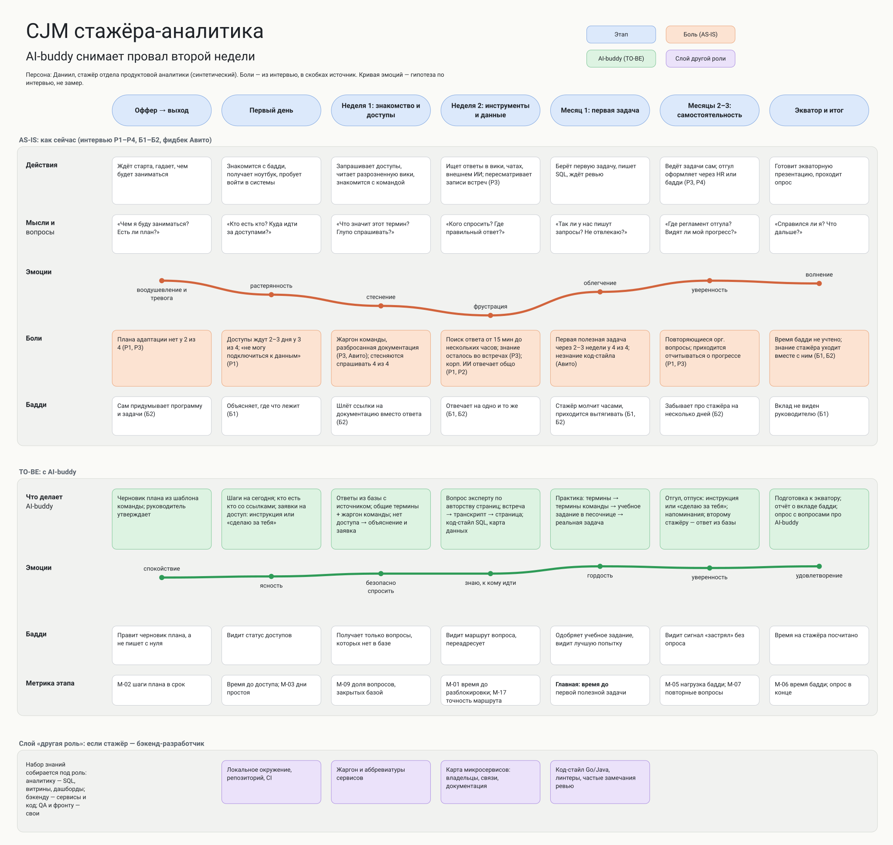

# CJM стажёра: как сейчас и с AI-buddy

> **Визуальная версия:** доска [CJM стажёра AI-buddy](https://claude.ai/artifact/SFSu5dbPT56dUQ8RootHfx) (открывается после того, как владелец поделится ссылкой).
> **Персона:** Даниил, стажёр отдела продуктовой аналитики (синтетический, [06-TEST-PERSONAS.md](../03-requirements/06-TEST-PERSONAS.md)). Аналитик выбран специально: кейс не только про бэкенд. Отличия для разработчика — отдельным слоем в конце.
> **Источники:** интервью [стажёров Р1–Р4](../01-discovery/interviews/intern-interviews.md) и [бадди Б1–Б2](../01-discovery/interviews/buddy-interviews.md), фидбек представителя Авито. В скобках — откуда боль.
> **Ограничение:** эмоции — гипотеза по интервью, а не замер. Этапы совпадают с этапами шаблона плана адаптации.

*Картинка — копия доски на 11.11.2026. Если доску поправили, картинку нужно обновить.*

## Главный вывод

Провал приходится на конец первой и вторую неделю: стажёр уже получил задачи, но не знает терминов, правил команды и того, кого спросить, и стесняется спрашивать. Бадди в это же время отвечает на одни и те же вопросы или забывает про стажёра. AI-buddy закрывает именно этот провал: ответы из базы, вопрос нужному человеку, практика перед первой задачей.

## AS-IS: как сейчас

| Этап | Действия | Мысли и вопросы | Эмоция | Боли | Бадди |
|---|---|---|---|---|---|
| Оффер → выход | Ждёт старта, гадает, чем будет заниматься | «Чем я буду заниматься? Есть ли план?» | воодушевление и тревога | Плана адаптации нет у 2 из 4 (Р1, Р3) | Сам придумывает программу и задачи (Б2) |
| Первый день | Знакомится с бадди, получает ноутбук, пробует войти в системы | «Кто есть кто? Куда идти за доступами?» | растерянность | Доступы ждут 2–3 дня у 3 из 4; «не могу подключиться к данным» (Р1) | Объясняет, где что лежит (Б1) |
| Неделя 1: знакомство и доступы | Запрашивает доступы, читает разрозненную вики, знакомится с командой | «Что значит этот термин? Глупо спрашивать?» | стеснение | Жаргон команды, разбросанная документация (Р3, Авито); стесняются спрашивать 4 из 4 | Шлёт ссылки на документацию вместо ответа (Б2) |
| Неделя 2: инструменты и данные | Ищет ответы в вики, чатах, внешнем ИИ; пересматривает записи встреч (Р3) | «Кого спросить? Где правильный ответ?» | **фрустрация — низшая точка** | Поиск ответа от 15 минут до нескольких часов; знание осталось во встречах (Р3); корпоративный ИИ отвечает общо (Р1, Р2) | Отвечает на одно и то же (Б1, Б2) |
| Месяц 1: первая задача | Берёт первую задачу, пишет SQL, ждёт ревью | «Так ли у нас пишут запросы? Не отвлекаю?» | облегчение | Первая полезная задача через 2–3 недели у 4 из 4; незнание код-стайла (Авито) | Стажёр молчит часами, приходится вытягивать (Б1, Б2) |
| Месяцы 2–3: самостоятельность | Ведёт задачи сам; отгул оформляет через HR или бадди (Р3, Р4) | «Где регламент отгула? Видят ли мой прогресс?» | уверенность | Повторяющиеся организационные вопросы; приходится отчитываться о прогрессе (Р1, Р3) | Забывает про стажёра на несколько дней (Б2) |
| Экватор и итог | Готовит экваторную презентацию, проходит опрос | «Справился ли я? Что дальше?» | волнение | Время бадди не учтено; знание стажёра уходит вместе с ним (Б1, Б2) | Вклад не виден руководителю (Б1) |

## TO-BE: с AI-buddy

| Этап | Что делает AI-buddy | Эмоция | Бадди | Метрика этапа |
|---|---|---|---|---|
| Оффер → выход | Черновик плана из шаблона команды; руководитель утверждает (P4) | спокойствие | Правит черновик плана, а не пишет с нуля | M-02 шаги плана в срок |
| Первый день | Шаги на сегодня; кто есть кто со ссылками; заявки на доступ: инструкция или «сделаю за тебя» (P4, P6) | ясность | Видит статус доступов | M-24 время до доступов; M-03 дни простоя |
| Неделя 1: знакомство и доступы | Ответы из базы с источником; общие термины и жаргон команды; нет доступа → объяснение и заявка без раскрытия закрытого (P1, BR-45, BR-88) | безопасно спросить | Получает только вопросы, которых нет в базе | M-09 доля вопросов, закрытых базой |
| Неделя 2: инструменты и данные | Вопрос эксперту по авторству страниц; встреча → транскрипт → страница; код-стайл SQL и карта данных (P1, P3) | знаю, к кому идти | Видит маршрут вопроса, переадресует | M-01 время до разблокировки; M-17 точность маршрута |
| Месяц 1: первая задача | Практика: термины → термины команды → учебное задание в песочнице → реальная задача (P7) | гордость | Одобряет учебное задание, видит лучшую попытку | **Главная:** время до первой полезной задачи; M-22, M-23 |
| Месяцы 2–3: самостоятельность | Отгул, отпуск: инструкция или «сделаю за тебя»; напоминания; второму стажёру — ответ из базы (P6, P4) | уверенность | Видит сигнал «застрял» без опроса | M-05 нагрузка бадди; M-07 повторные вопросы |
| Экватор и итог | Подготовка к экватору; отчёт о вкладе бадди; опрос с вопросами про AI-buddy | удовлетворение | Время на стажёра посчитано | M-06 время бадди; опрос в конце |

## Слой другой роли: стажёр — бэкенд-разработчик

Процесс тот же, меняется набор знаний роли (BR-87). Отличия по этапам:

| Этап | Что нужно знать бэкенду | Где в AI-buddy |
|---|---|---|
| Первый день | Локальное окружение, репозиторий, CI | Шаги плана типа `setup`, страницы базы |
| Неделя 1 | Жаргон и аббревиатуры сервисов | Глоссарий набора `backend` |
| Неделя 2 | Карта микросервисов: владельцы, связи, документация | Карта сервисов (в MVP — мок `role-knowledge.json`; в Авито — из каталога сервисов, если он есть) |
| Месяц 1 | Код-стайл Go/Java, линтеры, частые замечания ревью | Практика P7 с учебным заданием по коду |

Аналитику в тех же местах нужны SQL-стиль, нейминг таблиц и графиков, витрины и дашборды. Для QA и фронтенда наборы собираются так же.

## Что из CJM пошло в требования

| Вывод | Где |
|---|---|
| Провал второй недели — термины, правила команды, «кого спросить» | P1, P7, BR-88, US-33, US-36 |
| Доступы — главная боль первого дня | P6, US-31, US-37, BR-45, M-24 |
| Стажёр не знает код-стайл и архитектуру | P7, BR-87, US-36 |
| Бадди не хочет придумывать задания, но хочет видеть результат | BR-102, BR-105, US-34, US-35 |
| Права и закрытые данные | [02-ROLES.md](../03-requirements/02-ROLES.md#6-модель-доступа-rbac-и-abac), BR-45…BR-48 |
