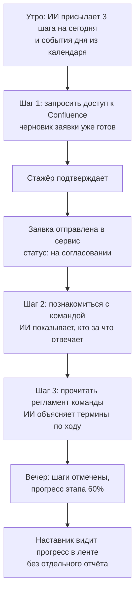
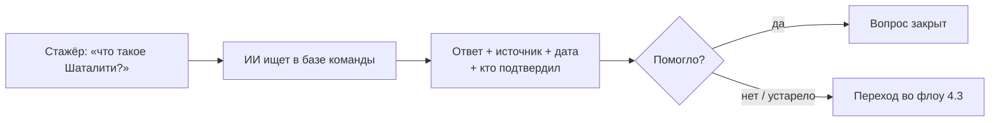
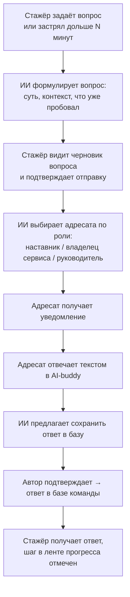
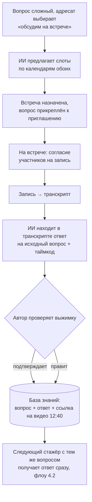
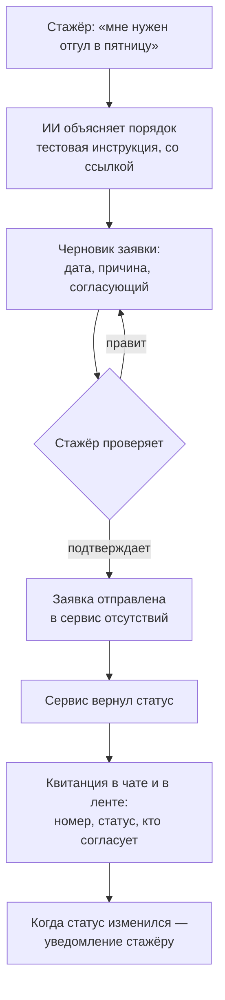
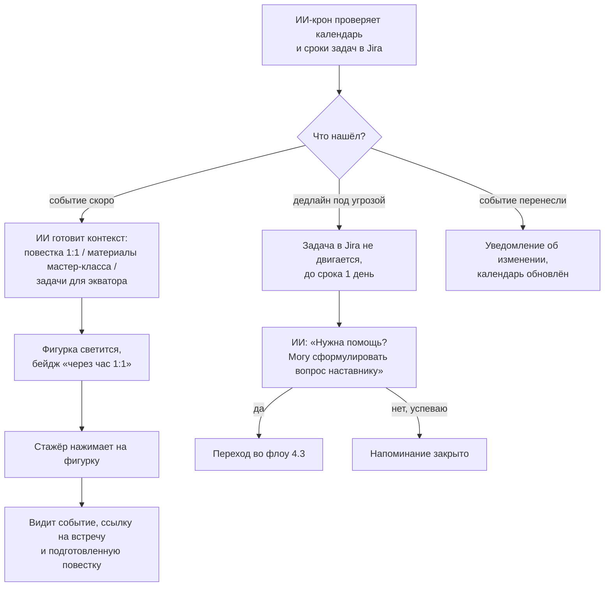
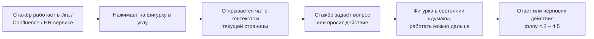

# AI-buddy: идеи, выбранная концепция и флоу

> Кратко о том, к чему мы пришли. Подробности и источники: [BRAINSTORM.md](../01-discovery/BRAINSTORM.md), [HYPOTHESES.md](./HYPOTHESES.md).
> Документ отражает концепцию до интервью с бадди. Актуальные требования для разработки — в [03-requirements](../03-requirements/README.md); где они расходятся с этим документом, действуют требования.

---

## 1. Все идеи коротко

| # | Идея | Решение |
|---|---|---|
| A | ИИ ведёт стажировку: каждый день предлагает «шаги на сегодня» | берём |
| B | Вопрос, на который нет ответа, ИИ сам формулирует и отправляет нужному человеку | берём |
| C | Ответ можно дать текстом или на встрече; запись встречи → транскрипт → ответ в базу знаний | берём |
| D | Лестница доверия к действиям: черновик → подтверждение → выполнение → квитанция | берём |
| E | Общая лента прогресса для стажёра, наставника, руководителя и куратора | берём |
| F | Таймбокс: «застрял больше N минут — помогу спросить» | берём (часть B) |
| G | Качество измерено на эталонном наборе вопросов, в каждом ответе ссылка на источник | берём |
| L | Календарь стажировки: события и дедлайны в одном месте, ИИ сам напоминает | берём (новое) |
| M | Маскот: постоянная фигурка на экране, к которой можно обратиться в любой момент | берём (новое) |
| H | Паспорт команды за 10 минут: жаргон, роли, каналы | если хватит времени |
| I | Честные границы: оценку, выход в штат и конфликты ведёт только человек | если хватит времени |
| J | Сигнал «документ устарел» владельцу | если хватит времени |
| K | Обычный чат-бот по вики без интеграций | не берём |

---

## 2. Выбранная концепция

> **AI-buddy ведёт стажёра по стажировке, а прогресс видят все. Каждый вопрос стажёра превращается в знание команды.**

**Опора 1. Ведёт, напоминает и показывает прогресс (A + E + L)**
- Каждый день стажёр получает 1–3 шага из этапа адаптации (по чек-листу Авито).
- Первый шаг уже подготовлен, например черновик заявки на доступ.
- Все события и дедлайны стажировки собраны в одном календаре, ИИ напоминает о них заранее.
- Наставник, руководитель и куратор видят ту же ленту: что сделано, что дальше, где затык.

**Опора 2. Вопрос → ответ → знание команды (B + C + F)**
- Ответ есть в базе — ИИ сразу отвечает и даёт ссылку на источник.
- Ответа нет — ИИ сам формулирует вопрос нужному человеку.
- Человек отвечает текстом или назначает через ИИ встречу.
- Запись встречи → транскрипт → ИИ выделяет ответ → автор подтверждает → ответ попадает в базу со ссылкой на нужный момент видео.
- Следующий стажёр получает этот ответ без нового созвона.

**Основа доверия (D + G)**
- Любое действие проходит путь «черновик → подтверждение → выполнение → квитанция».
- Недоступное по правам ИИ не показывает и не выполняет.
- У каждого ответа есть источник и дата.

**Лицо продукта (M)**
- AI-buddy живёт не во вкладке, которую надо найти, а в виде фигурки-маскота, которая всегда на экране.
- Обратиться к нему можно в один клик из любой рабочей системы.

**Почему это выделяет нас**
- Мы закрываем самую частую боль стажёров — хаос в организации стажировки, а не только «где найти инструкцию».
- Наставник отвечает на вопрос один раз, и база растёт с каждым стажёром. Это напрямую экономит 40–48 часов наставника из кейса.
- Знание из встреч перестаёт теряться.
- Стажёр не пропускает мастер-классы, экватор и дедлайны, а наставнику не нужно о них напоминать.
- Помощник всегда под рукой: стажёру не нужно вспоминать, где он живёт, и стесняться «лишний раз спросить».

---

## 2.1 Календарь стажировки (L)

**Зачем.** В исследовании стажёры жалуются на хаос: о встречах, мастер-классах и сроках узнают в последний момент из разных чатов. В чек-листе наставника Авито есть обязанность «напоминать о дедлайнах, мастер-классах, экваторе» — это чистая логистика, которую можно забрать у человека.

**Что попадает в календарь**

| Тип события | Откуда берётся |
|---|---|
| Встречи 1:1 с наставником, встречи команды | Корпоративный календарь |
| Мастер-классы, обучение, общие мероприятия стажёров | Календарь программы стажировки |
| Экватор, выпускной, промежуточные ревью | Этапы чек-листа Авито |
| Дедлайны задач | Поле due date в Jira |
| Сроки по заявкам (доступы, согласия, документы) | Сервисы из кейса |
| Встречи, назначенные через AI-buddy (флоу 4.4) | Создаются самим AI-buddy |

**Как работают напоминания**
- **Утренний дайджест** вместе с шагами на день: что сегодня, что на этой неделе, ближайший дедлайн.
- **Напоминание заранее** — по умолчанию за день и за час до события; стажёр может поменять интервалы.
- **Подготовка к событию**, а не просто «через час встреча»: перед 1:1 ИИ присылает повестку из вопросов и затыков стажёра, перед экватором — список выполненных задач для презентации.
- **Риск по дедлайну:** если до срока задачи в Jira осталось мало времени, а задача не двигается, ИИ спрашивает, нужна ли помощь, и предлагает сформулировать вопрос наставнику (флоу 4.3).
- **Изменения:** встречу перенесли или отменили — стажёр получает уведомление.

**Границы**
- Календарь AI-buddy — это вид поверх корпоративного календаря и Jira, а не отдельная система. Своих событий в обход календаря он не хранит.
- Создать или перенести встречу можно только через лестницу доверия: черновик → подтверждение.
- Напоминания не должны раздражать: есть режим «не беспокоить» и рабочие часы, вне которых ИИ молчит.
- Наставник и куратор видят события стажёра в ленте прогресса, но не получают его личные напоминания.

---

## 2.2 Маскот — постоянная фигурка помощника (M)

**Идея.** AI-buddy — это фигурка-маскот (маленький зверёк, изображение команда подобрала), которая всегда видна в углу экрана. Не нужно открывать отдельный сервис: увидел вопрос — нажал на фигурку — спросил.

**Где живёт фигурка**
- В прототипе — плавающий виджет поверх веб-интерфейса (имитация рабочих систем).
- При внедрении — расширение браузера или виджет в корпоративном мессенджере и внутреннем портале, чтобы фигурка была видна поверх Jira, Confluence и HR-сервисов.

**Состояния фигурки** — она сама показывает, что происходит, без лишних уведомлений:

| Состояние | Когда | Как выглядит |
|---|---|---|
| Спокойное | Всё в порядке | Фигурка просто сидит в углу |
| Есть напоминание | Скоро событие или дедлайн | Мягко светится / подмигивает, на ней маленький бейдж |
| Ждёт подтверждения | Черновик заявки или вопроса готов | Держит «листок», клик открывает черновик |
| Думает | ИИ обрабатывает запрос | Анимация «думаю…», интерфейс не блокируется |
| Пришёл ответ | Наставник ответил на вопрос | Радуется, бейдж с ответом |

**Как с ней взаимодействовать**
- Клик — открывается чат, а в нём контекст текущей страницы (например, стажёр в задаче Jira — ИИ уже знает, о какой задаче вопрос).
- Наведение — короткая подсказка: ближайшее событие или «ответ на твой вопрос готов».
- Фигурку можно перетащить, свернуть до маленькой точки или скрыть на время.

**Почему это работает**
- Снижает барьер «неловко спросить»: обратиться к дружелюбному зверьку проще, чем писать наставнику.
- Помощник всегда на виду — им пользуются регулярно, а не забывают через неделю.
- Состояния фигурки заменяют часть уведомлений: стажёр видит, что что-то ждёт его внимания, но его не дёргают.

**На что обратить внимание**
- Права на изображение: для демо использовать картинку, которую можно использовать (или нарисовать своего персонажа по мотивам), и указать источник.
- Доступность: состояния передаются не только цветом и анимацией, но и бейджем/подписью; анимации отключаются в настройках.
- Фигурка не должна закрывать рабочие элементы интерфейса.

---

## 3. Роли

| Роль | Что делает в AI-buddy |
|---|---|
| Стажёр | Получает шаги на день и напоминания, задаёт вопросы через фигурку, подтверждает действия, видит свой прогресс и календарь |
| Наставник | Отвечает на вопросы текстом или на встрече, подтверждает ответы для базы, видит прогресс и ключевые события стажёра |
| Руководитель | Видит прогресс и затыки, согласует заявки в рамках своих прав |
| Куратор / HR | Видит этапы всех стажёров, ведёт календарь программы (мастер-классы, экватор), получает сигналы «застрял» и «простаивает» |

---

## 3.1 Роль наставника: что забирает AI-buddy, а что остаётся человеку

Кейс требует, чтобы AI-buddy **сокращал рутинные обращения и организационные действия, но не заменял содержательную работу наставника**.

Время наставника по оценке Авито: 40–48 ч за 6 месяцев, 55–65 ч за 9 месяцев. Сюда входят встречи 1:1, работа с куратором, обучение, ревью компетенций, обратная связь, экватор и выпускной.

Обязанности наставника из [чек-листа Авито](https://docs.google.com/spreadsheets/d/1qKFqOzfSZ2jEz57jBSmq7rukDXi_tRfWohgemViceV0/edit?usp=sharing), разделённые на две части:

| Задача наставника | Тип | Кто делает |
|---|---|---|
| Добавить стажёра в чаты и каналы, проверить, запросил ли он доступы | организационная | **AI-buddy**: напоминает, готовит заявки, показывает статус |
| Назначить регулярные 1:1 | организационная | **AI-buddy** подбирает слоты, **наставник** подтверждает |
| Узнавать, на каком этапе стажёр («как дела, что сделал?») | организационная | **AI-buddy**: лента прогресса вместо отчётов |
| Отвечать на повторяющиеся и базовые вопросы | рутина | **AI-buddy**: база знаний команды |
| Напоминать о дедлайнах, мастер-классах, экваторе | организационная | **AI-buddy**: календарь стажировки и напоминания (раздел 2.1) |
| **Проводить 1:1: рассказывать об особенностях команды и задач** | содержательная | **Наставник**. AI-buddy готовит повестку из вопросов и затыков стажёра |
| **Обсуждать цели, план и критерии успешной стажировки** | содержательная | **Наставник**. AI-buddy фиксирует договорённости и показывает их в ленте |
| **Объяснять сложное: архитектуру, контекст, «почему так»** | содержательная | **Наставник** на встрече. AI-buddy сохраняет ответ из транскрипта в базу |
| **Ревью работы и компетенций, обратная связь** | содержательная | **Только наставник**. AI-buddy не оценивает стажёра |
| **Подготовка к экватору: проверить презентацию, провести репетицию, сказать напутственное слово** | содержательная | **Наставник**. AI-buddy напоминает и собирает выполненные задачи для презентации |
| **Поддержка, когда стажёру тяжело** | содержательная | **Только наставник**. AI-buddy замечает сигнал («застрял», «простаивает») и передаёт его человеку |

**Принцип:** AI-buddy забирает у наставника логистику, статусы и повторы, чтобы его время уходило на объяснение, ревью и обратную связь.

**Как встреча с транскриптом вписывается в эту логику.** Это не замена наставника, а усилитель:
- ИИ назначает встречу и собирает контекст вопроса;
- **объясняет на встрече наставник** — это содержательная часть;
- ИИ сохраняет ответ из транскрипта, **наставник подтверждает**, его имя стоит как автор ответа;
- в следующий раз наставник тратит время на новый сложный вопрос, а не на повтор старого.

**Чего AI-buddy не делает никогда:**
- не оценивает стажёра и не делает выводов о его готовности;
- не отвечает от имени наставника без подтверждения;
- не отвечает на вопросы о переходе в штат и об оценке — передаёт их человеку.

---

## 3.2 Интеграции: работаем в корпоративных системах, а не рядом с ними

Свой трекер и свою вики AI-buddy не заводит. Всё, что он создаёт, появляется в системах, где команда и так работает.

**Почему Jira и Confluence.** Чек-лист стажёра Авито прямо называет их среди обязательных доступов первой недели: «Confluence, Jira и т.д.». Их же перечисляет [AvitoTech Playbook](https://github.com/avito-tech/playbook).

| Система | Что делает AI-buddy | Что видит команда |
|---|---|---|
| **Jira** (трекер) | Создаёт задачи и заявки от имени стажёра после подтверждения; заводит эпик адаптации со шагами чек-листа как подзадачами; читает статусы и сроки задач для напоминаний | Обычные задачи в своём проекте и на своей доске, а не «сообщения от бота» |
| **Confluence** (вики) | Ищет ответы в пространстве команды; подтверждённый наставником ответ сохраняет как страницу или раздел FAQ, со ссылкой на запись встречи | База знаний растёт там же, где вся документация команды |
| **Календарь** | Читает события стажёра и программы стажировки для напоминаний; подбирает слоты, создаёт встречу, прикрепляет к приглашению вопрос стажёра | Обычная встреча в календаре |
| **Сервисы из кейса** (отсутствия, чек-лист новичка, согласия) | Отгул, отметки шагов адаптации, согласия, сроки по заявкам | Заявки в штатных HR-сервисах |
| **Мессенджер / портал / браузер** | Показывает фигурку-маскота и уведомления там, где стажёр работает | Виджет помощника, без отдельного приложения |

**Как связаны лента прогресса и Jira:**
- шаг адаптации = подзадача в эпике стажёра в Jira;
- лента прогресса в AI-buddy читает статусы из Jira, отдельной базы прогресса нет;
- наставник может работать прямо в Jira, а AI-buddy подхватит изменения.

**Как это сделано в прототипе.** Требование кейса: сервисы имитируются.
- Каждая система подключена через **MCP-сервер-адаптер** с API в формате Jira REST и Confluence REST.
- В демо адаптеры работают с заглушками, в которых лежат синтетические данные двух команд.
- Напоминания запускает планировщик (ИИ-крон): раз в N минут проверяет календарь и сроки задач и решает, о чём напомнить.
- Если в Авито другой трекер или вики, меняется только адаптер, а агент и сценарии остаются прежними. Это главный аргумент для критерия «внедряемость и интеграции» (30% онлайн-оценки).
- Права проверяются **до** вызова инструмента: стажёр видит только пространства и проекты своей команды.

---

## 4. Флоу

### 4.1 День стажёра — успешный путь

**Альтернативы**
- Шаг не выполнен до вечера → утром ИИ переносит его и спрашивает, нужна ли помощь.
- Стажёр несколько дней без активности → куратор получает мягкий сигнал «простаивает».
- Стажёр перегружен и пропускает шаги → ИИ предлагает обсудить темп с наставником.

---

### 4.2 Вопрос, ответ есть в базе

---

### 4.3 Вопрос, ответа нет: ответ текстом (фишка)

---

### 4.4 Вопрос, ответа нет: ответ через встречу (фишка)

**Альтернативы**
- Участник не согласен на запись → встреча проходит без записи, ИИ предлагает автору записать ответ текстом.
- Автор не подтвердил выжимку за N дней → напоминание; без подтверждения в базу ничего не попадает.

---

### 4.5 Действие через сервис: отгул (лестница доверия)

**Альтернативы**
- Нет прав на операцию → ИИ объясняет причину и готовит запрос тому, у кого право есть.
- Сервис недоступен → понятная ошибка, черновик сохранён, кнопка «повторить».
- LLM отвечает долго → интерфейс не блокируется, виден статус «думаю…».
- LLM упала или молчит → упрощённый режим: тот же порядок действий по правилам — черновик, «Подтвердить», квитанция; под ответом кнопки частых действий. Стажёр не остаётся без помощи (BR-70).

---

### 4.6 Напоминание о событии и дедлайне (новое)

**Альтернативы**
- Нерабочее время или режим «не беспокоить» → напоминание приходит в начале рабочего дня, если событие не раньше.
- Стажёр отложил напоминание («напомни через 15 минут») → ИИ напомнит повторно.
- Событие из календаря программы изменил куратор → всем стажёрам программы приходит обновление.

---

### 4.7 Обращение через фигурку-маскота 

---

## 5. Сценарий демо (5 минут)

1. **Фигурка на экране:** стажёр открывает рабочую систему, в углу сидит маскот. *(M)*
2. **Утро стажёра:** по клику на фигурку — 3 шага на день и события из календаря, первый шаг — готовый черновик заявки на доступ. Подтверждение → квитанция. *(A, D, L)*
3. **Вопрос из базы:** «Что такое Шаталити?» → ответ с источником. *(G)*
4. **Вопрос без ответа:** ИИ формулирует вопрос → наставник назначает встречу, она появляется в календаре. *(B, C, L)*
5. **Магия:** транскрипт встречи → выжимка → наставник подтверждает → ответ в базе с таймкодом. *(C)*
6. **Напоминание:** фигурка светится — «через час 1:1», внутри готовая повестка из вопросов стажёра. *(L, M)*
7. **Второй стажёр** задаёт тот же вопрос → получает ответ сразу. *(эффект базы)*
8. **Экран наставника:** лента прогресса — кто где, кто застрял, ближайшие события. *(E)*
9. **Права:** стажёр просит то, что ему недоступно → вежливый отказ и запрос руководителю. *(D)*
