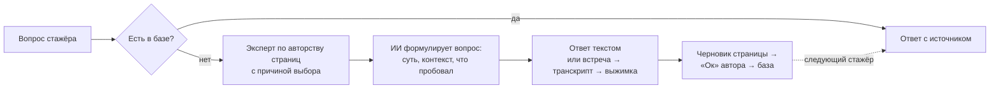

# 01. PRD: AI-buddy

> Hack&Change 2026 · кейс Авито «AI-buddy: ИИ-наставник для стажёров».
> Основа: [HYPOTHESES.md](../02-concept/HYPOTHESES.md), [IDEA-AND-FLOWS.md](../02-concept/IDEA-AND-FLOWS.md), интервью [стажёров](../01-discovery/interviews/intern-interviews.md) и [бадди](../01-discovery/interviews/buddy-interviews.md), [вводные Авито](../01-discovery/avito-inputs.md).
> Где этот документ расходится с IDEA-AND-FLOWS.md, действует этот документ.

## 1. Проблема

**Что говорят данные Авито** ([вводные Авито](../01-discovery/avito-inputs.md)). Онбординг в Авито уже работает хорошо: удовлетворённость 9/10, наставником — 90%. Но держится он на наставнике: ~5 ч в неделю в первые 2–3 месяца, и больше всего вопросов организационных — доступы, оборудование, документы. Самое слабое место — чек-лист: им довольны 68%. Поэтому задача AI-buddy — не чинить онбординг, а сохранить его качество, сняв с наставника рутину и заменив статичный чек-лист планом, который ведёт стажёра.

**Что говорят стажёры** (наши интервью, другие компании):

- До первой полезной задачи стажёр идёт **2–3 недели** — так ответили все четверо опрошенных.
- Стажёры стесняются спрашивать и часами ищут ответ сами; бадди, наоборот, жалуются, что стажёр «молчит часами», хотя вопрос решился бы за 5 минут.
- Плана адаптации часто нет, а бадди не хотят сами придумывать программу, задачи и контроль.
- Знание из встреч теряется: стажёры пересматривают записи созвонов и всё равно не находят ответ.
- Корпоративные ИИ-ассистенты уже есть, но «отвечают общо»: не знают команду.
- Время бадди на стажёра не учитывается, и помощь стажёру конкурирует с основной работой.
- По словам представителя Авито, чаще всего стажёры не знают код-стайл, архитектуру систем и микросервисов, в которых начинают работать, и жаргон команды.

## 2. Ценностное предложение

> **AI-buddy ведёт стажёра по стажировке, а прогресс видят все. Каждый вопрос стажёра превращается в знание команды.**

| Для кого | Что получает |
|---|---|
| Стажёр | План на каждый день, ответы с источником, безопасное место для «глупых» вопросов, помощь с вопросом к нужному человеку, заявки (отгул и др.) без поиска регламента |
| Бадди | Готовый план, меньше повторяющихся вопросов, видит, где стажёр застрял, без «вытягивания»; вопросы приходят с контекстом и пачкой |
| Эксперт команды | Вопрос уже сформулирован, отвечает один раз — ответ попадает в базу под его авторством |
| Руководитель | Видит прогресс стажёров и нагрузку бадди и экспертов; поддерживает базу знаний в актуальном состоянии |

## 2a. Киллер-фича: вопрос без ответа становится знанием команды

> Если ответа нет в базе, AI-buddy не говорит «не знаю, спроси наставника». Он находит человека, который знает, сам формулирует ему вопрос с контекстом, а ответ, текстом или со встречи, превращает в страницу базы под авторством ответившего. Следующий стажёр получает этот ответ за секунды.

**Почему именно это — киллер-фича**

| Боль | Откуда | Как закрывает фича |
|---|---|---|
| Стажёр не знает, кого спросить, и стесняется | Р1, Р2, Р4 | ИИ называет человека и причину выбора, сам формулирует вопрос; стажёру остаётся подтвердить |
| Корпоративный ИИ «отвечает общо», не знает команду | Р1 | Отвечаем только из базы команды с источником, а то, чего в базе нет, добываем у людей |
| Знание остаётся во встречах | Р3 | Из записи встречи в базу попадает ответ с таймкодами |
| Бадди отвечает на одно и то же, стажёр молчит часами | Б1, Б2 | Человек отвечает один раз, дальше отвечает база; вопрос приходит сформулированным и пачкой |

**Чем отличается от обычного корпоративного ассистента.** Обычный ассистент ищет по готовой базе, и если ответа нет, разговор заканчивается. AI-buddy закрывает пробел и пополняет базу, поэтому польза растёт с каждым стажёром: ко второму стажёру в отделе база должна закрывать не меньше половины вопросов ([M-09](./09-METRICS.md)).

**Где видно в демо:** D3 → D4 или D5 → D6 (сценарии SC-04, SC-10, SC-12): Даниил задаёт вопрос, Михаил отвечает, через месяц Полина получает тот же ответ из базы без людей.

**Ядро MVP, без которого фича не работает:** F1, F2, F3, F8, F12, F13. Остальные функции (план и ведение, заявки, практика, маскот, Telegram) усиливают продукт, но не заменяют фичу.

**Удобство для бадди и руководителя** — в [10-ROLE-VALUE.md](./10-ROLE-VALUE.md), **интеграция с системами Авито** — в [11-INTEGRATION.md](./11-INTEGRATION.md).

## 3. Цели MVP

1. Показать полный путь «вопрос → ответ → страница в базе знаний» по всем веткам: база, эксперт, бадди, встреча.
2. Показать ведение стажёра: план адаптации, шаги на день, прогресс, напоминания.
3. Показать действие через корпоративный сервис (имитация): отгул.
4. Показать, что права соблюдаются: каждая роль видит только своё.
5. Подтвердить пользу метриками ([09-METRICS.md](./09-METRICS.md)).
6. Показать практику перед первой задачей: термины → термины команды → учебное задание → реальная задача.

## 4. Решение в одном абзаце

Внутреннее веб-приложение с отдельными интерфейсами для стажёра, бадди, эксперта и руководителя. Стажёр общается с ИИ через маскота-зверька в углу экрана. ИИ ищет ответ в базе знаний команды; если не находит — определяет эксперта по авторству страниц и с согласия стажёра отправляет ему сформулированный вопрос, а если эксперт не определён — бадди. Ответ текстом или через встречу (запись → транскрипт → выжимка) превращается в страницу базы знаний, которую подтверждает автор ответа. Уведомления дублируются в Telegram. Интеграции с Jira, Confluence, календарём и HR-сервисами сделаны через адаптеры; в прототипе адаптеры работают с заглушками.

## 5. Границы MVP

### Входит

| # | Возможность | Где описано |
|---|---|---|
| F1 | Маршрутизация вопроса: база → эксперт → бадди | P1, BR-10…BR-19 |
| F2 | Ответ текстом → черновик страницы → подтверждение автором | P2 |
| F3 | Ответ через встречу: слоты, напоминание включить запись, транскрипт, выжимка, страница | P3 |
| F4 | План адаптации из шаблона команды, шаги на день, прогресс | P4 |
| F5 | Знакомство с командой: ИИ рассказывает, кто есть кто, со ссылками, и даёт черновик сообщения | P4, US-06 |
| F6 | Отгул и другие заявки через сервис отсутствий, доступы через сервис доступов (имитации): объяснить порядок → «сделай сам» или «сделаю за тебя» | P6, US-31 |
| F7 | Календарь стажировки и напоминания о событиях и дедлайнах | P4, US-08 |
| F8 | Поддержка базы: папки, дубли, открытые вопросы, черновики без «Ок», «устарело». Плановая проверка раз в 4 месяца ищет похожие страницы и шлёт владельцу сводку; «Проверить сейчас» — по кнопке. Владельца назначает руководитель (BR-34) | P5 |
| F9 | Сводки вопросов для получателей и срочные вопросы | BR-20…BR-24 |
| F10 | Уведомления в Telegram (только уведомления) | BR-50…BR-53 |
| F11 | Маскот-виджет в вебе: состояния, сон, пробуждение; наклон к курсору в «3D», перетаскивание к краю, «свернуть», «скрыть на час» | [08-DESIGN.md](./08-DESIGN.md) |
| F12 | Интерфейсы четырёх ролей, переключатель тестовых учёток | [07-FRONTEND.md](./07-FRONTEND.md) |
| F13 | Права по ролям (RBAC) и наследование прав на данные из источников (ABAC, допущение) | [02-ROLES.md](./02-ROLES.md), BR-40, BR-45…BR-48 |
| F14 | Практика перед задачей: термины, учебное задание, одобренное бадди, проверка попытки | P7, US-33…US-35, BR-100…BR-106 |
| F15 | Набор знаний под роль: глоссарий и жаргон, код-стайл, карта данных или сервисов; MVP — аналитик, пример для бэкенда | US-36, BR-87, BR-88 |
| F16 | Сторожа сроков: SLA ответа (напоминание адресату, затем бадди), сигнал бадди о простое стажёра, автоактивация неутверждённого плана | BR-18, BR-85, BR-81, [spec/07](../spec/07-notifications.md) |
| F17 | Проверка качества агента: эталонный набор вопросов, отчёт M-14…M-17 и прав, барьер в тестах | H7, [09-METRICS.md](./09-METRICS.md), [docs/evals](../evals/live.md) |
| F18 | Инструменты агента как MCP-сервер — те же права, действия только черновиком | Кейс, «Пространство решений», [spec/08](../spec/08-mcp.md) |
| F19 | Готовность к внедрению: интерфейсы сервисов (за ними имитации), выгрузка событий в аналитику, feature flags | BR-74, [11-INTEGRATION.md](./11-INTEGRATION.md), [spec/09](../spec/09-adapters.md) |
| F20 | Профили сотрудников: карточка стажёра с фото, ФИО, статусом, отделом, рабочими телефоном и почтой; свой телефон и фото правит сам | US-38, [02-ROLES.md](./02-ROLES.md), [spec/05](../spec/05-tools-api.md#профили-сотрудников-us-38) |
| F21 | Упрощённый режим без модели: модель упала или молчит — правила ведут по тому же порядку действий (черновик → подтверждение → квитанция), кнопки частых действий роли; последний рубеж — ответ из базы без пересказа | BR-70, US-29, SC-26 |

### Не входит в MVP

- Маскот поверх всех окон (десктоп-приложение) и расширение браузера — следующий шаг.
- Реальные интеграции с Jira, Confluence, календарём, ВКС и HR-системами — по кейсу не нужны (ограничения 02, 04): в MVP имитации на синтетических данных за интерфейсами адаптеров; для примера подключения есть REST-клиент сервиса отсутствий.
- Реальная запись и распознавание речи — в MVP готовые транскрипты-заглушки.
- Ответы на вопросы в Telegram и чат с ИИ в Telegram — только уведомления.
- Роль куратора / HR BP и календарь программы стажировки на уровне всех стажёров.
- Оценка стажёра, решения о выходе в штат, конфликты — всегда передаются человеку ([BR-60](./04-BUSINESS-RULES.md)).
- Увольнения, бенефиты, финансовые операции, чувствительные ПДн (ограничение 06 кейса).
- Отправка сообщений коллегам от имени ИИ при знакомстве с командой — стажёр пишет сам.
- Маршрут вопросов по задаче к автору тикета в трекере: вторая по частоте категория вопросов у Авито — по задачам ([вводные Авито](../01-discovery/avito-inputs.md)). Следующий шаг после MVP: вопрос о формулировке задачи уходит её автору, о приоритизации и ревью — бадди.

## 6. Допущения и ограничения

| # | Допущение / ограничение | Следствие |
|---|---|---|
| A1 | Доступа к внутренним системам Авито нет | Своё веб-приложение; каждая система за адаптером (Jira REST, Confluence REST, календарь, сервис отсутствий) |
| A2 | Данные только синтетические | Отдел аналитики из [06-TEST-PERSONAS.md](./06-TEST-PERSONAS.md); тестовые инструкции помечены «тестовая инструкция, не регламент Авито» |
| A3 | Бэкенд на Go; фронт — на выбор команды, совместимый со стеком Авито (React + TypeScript) | Требования к фронту описаны независимо от фреймворка |
| A4 | Суть процесса не зависит от отдела | Демо на отделе аналитики; шаблон плана и папки базы — данные, а не код |
| A5 | Авторизация и роли в Авито существуют | В MVP — тестовые учётки и переключатель ролей, не своя система учёток |
| A6 | Внешние LLM | Не передаём ПДн и секреты; ключ через переменную окружения |
| A7 | Ограничения кейса по скорости | Локальные операции < 1 с; LLM и внешние вызовы не блокируют интерфейс, есть статус ожидания и обработка сбоев; без модели продукт работает в упрощённом режиме (F21) |
| A8 | В Авито роли и доступы распределяются по RBAC и ABAC; атрибуты ABAC нам неизвестны | Атрибуты описаны как допущение (отдел, роль, статус и неделя стажёра, проект, гриф); права наследуются из источников, а не копируются |
| A9 | Размер когорты стажёров и данные прошлых наборов неизвестны; время до первой задачи Авито оценивает в ~2 недели, но не измеряет | Базу собираем сами в первые недели пилота; проверка — волнами по командам и A/B по функциям ([09-METRICS.md](./09-METRICS.md#4-как-проверить-эффект-на-стажёрах)) |
| A10 | У стажёра те же доступы, что у команды, включая стратегию и финансы, если этого требуют задачи ([вводные Авито](../01-discovery/avito-inputs.md)) | Права только наследуются из источников; отдельных ограничений для стажёра AI-buddy не вводит. Неделя в плане говорит, когда доступ запросить, а не когда он разрешён |
| A11 | Стажёру могут быть доступны конфиденциальные данные | Во внешнюю LLM не уходят ПДн, секреты и конфиденциальные данные; страница базы из ответа наследует самый закрытый гриф исходников (BR-49). В прототипе фильтр по грифу уже работает (SC-36); при внедрении — грифы из базы знаний Авито или внутренняя модель |

## 7. Основные сценарии демо

| # | Сценарий | Персоны |
|---|---|---|
| D1 | Утро стажёра: маскот просыпается, шаги на сегодня, событие дня | Даниил |
| D2 | Вопрос из базы: ответ с источником | Даниил |
| D3 | Вопрос к эксперту: ИИ нашёл автора страниц, уточнил, отправил; бадди видит запрос | Даниил, Михаил, Екатерина |
| D4 | Эксперт не определён → бадди отвечает текстом → черновик страницы → подтверждение | Даниил, Екатерина |
| D5 | Встреча: напоминание включить запись → транскрипт → выжимка → страница со ссылкой | Даниил, Ольга |
| D6 | Второй стажёр задаёт тот же вопрос → ответ сразу из базы | Полина |
| D7 | Отгул: порядок → «сделаю за тебя» → квитанция | Даниил |
| D8 | Руководитель: дашборд, нагрузка бадди, поддержка базы (дубли, открытые вопросы) | Андрей |
| D9 | Права: стажёр просит недоступное → отказ с объяснением | Даниил |
| D10 | Практика: термины команды → учебное задание → разбор ошибки → реальная задача; бадди видит лучшую попытку | Даниил, Екатерина |
| D11 | Нет доступа к витринам: срок по плану, согласующий, заявка; закрытое не названо | Даниил |
| D12 | Модель упала (`LLM_MODE=stub_error`): «Нужен отгул» → «на какую дату?» → «в пятницу» → черновик → квитанция; пометка «Упрощённый режим», кнопки частых действий | Даниил |

Полный список тестовых сценариев — [06-TEST-PERSONAS.md](./06-TEST-PERSONAS.md).

## 8. Риски

| Риск | Откуда | Что делаем |
|---|---|---|
| ИИ добавляет бадди нагрузку вместо экономии | Интервью Б2 | До людей доходит только то, чего нет в базе; сводки вместо поштучных сообщений; метрика нагрузки бадди |
| Стажёр слепо доверяет ИИ | Интервью Б1 | Источник и дата у каждого ответа; честное «не знаю» вместо выдумки |
| ИИ ошибся с адресатом | Логика маршрутизации | Стажёр видит, почему выбран эксперт; бадди видит маршрут и переадресует |
| Проактивность раздражает | Опыт Скрепыша (Clippy), интервью Р2 | Маскот реагирует только по поводу; режимы проактивности; рабочие часы |
| Запись встречи не включили | Реальная практика | Напоминание до и в начале встречи; без записи — предложить ответ текстом, иначе вопрос в бэклог базы |
| База зарастает дублями | Короткие ответы тоже идут в базу | Папки, поиск дублей, плановая проверка раз в 4 месяца (в прототипе — проверка по расписанию и по кнопке, решение «объединить / не дубль» за владельцем) |
| Права на изображение маскота | Персонаж Авито | Использовать официальный исходник от организаторов; до получения — заглушка |
| ИИ встаёт между стажёром и наставником | Наставником довольны 90% ([вводные Авито](../01-discovery/avito-inputs.md)) | 1-1, ревью и обратная связь остаются за наставником; удовлетворённость наставником — сдерживающая метрика M-26 |
| Конфиденциальные данные уходят во внешнюю модель или в базу шире, чем были | Стажёру доступны стратегия и финансы ([вводные Авито](../01-discovery/avito-inputs.md)) | BR-49: фильтр по грифу до LLM, страница наследует гриф исходников |
| Внешняя модель упала, тормозит или её отключили | Сторонний провайдер (DeepSeek), сеть | Упрощённый режим: те же инструменты, права и черновики по правилам; кнопки частых действий; экраны (план, заявки, вопросы) работают без модели. Модель заменяется через адаптер (BR-70, F21) |

## 9. Связанные документы

| Документ | Содержание |
|---|---|
| [02-ROLES.md](./02-ROLES.md) | Роли, матрица прав |
| [03-PROCESSES.md](./03-PROCESSES.md) | Процессы P1–P7 |
| [04-BUSINESS-RULES.md](./04-BUSINESS-RULES.md) | Бизнес-правила BR-xx |
| [05-USER-STORIES.md](./05-USER-STORIES.md) | User stories и критерии приёмки |
| [06-TEST-PERSONAS.md](./06-TEST-PERSONAS.md) | Персоны и тестовые сценарии |
| [07-FRONTEND.md](./07-FRONTEND.md) | Экраны, состояния, API для фронта |
| [08-DESIGN.md](./08-DESIGN.md) | Маскот, анимации, тон общения |
| [09-METRICS.md](./09-METRICS.md) | Метрики |
| [10-ROLE-VALUE.md](./10-ROLE-VALUE.md) | Удобство для бадди и руководителя: было → стало |
| [11-INTEGRATION.md](./11-INTEGRATION.md) | Интеграция с системами Авито через адаптеры |
| [12-RESILIENCE.md](./12-RESILIENCE.md) | Отказоустойчивость: что видит пользователь, когда модель или сервис недоступны |
