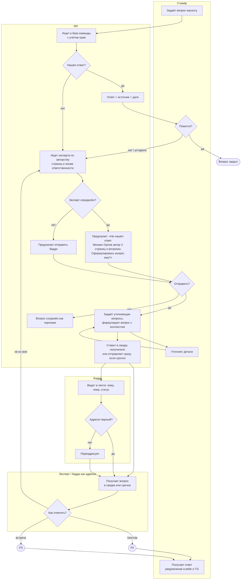
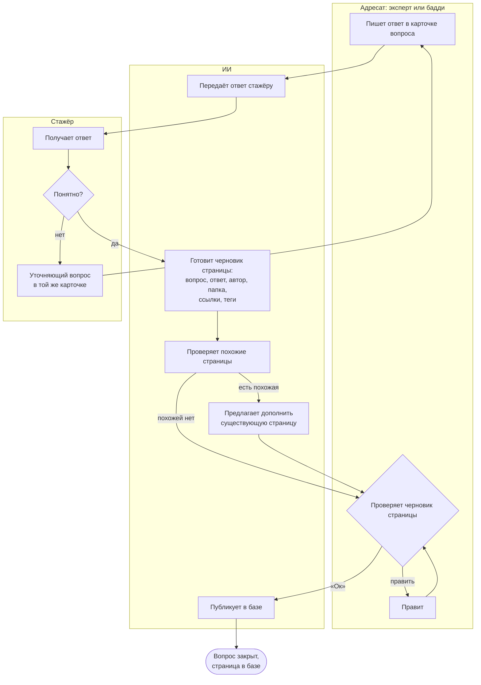
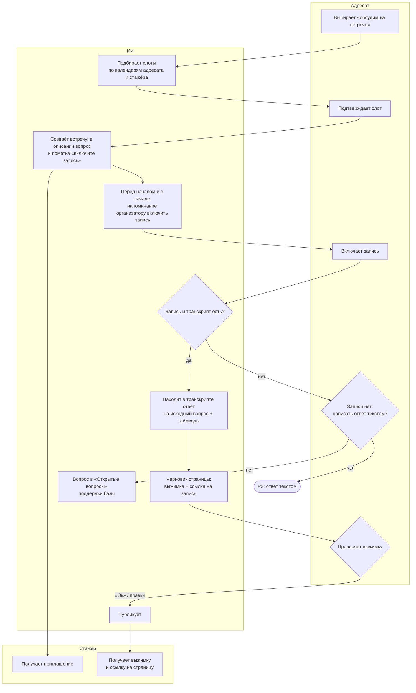
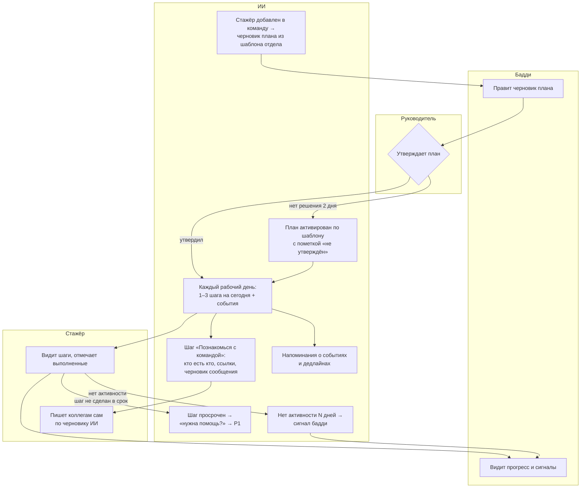
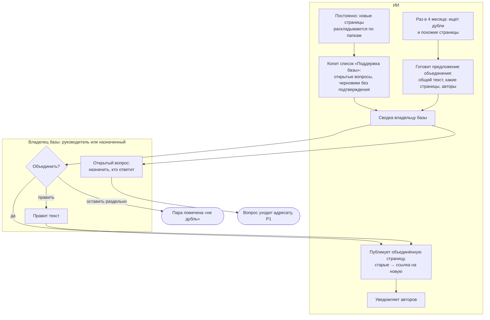
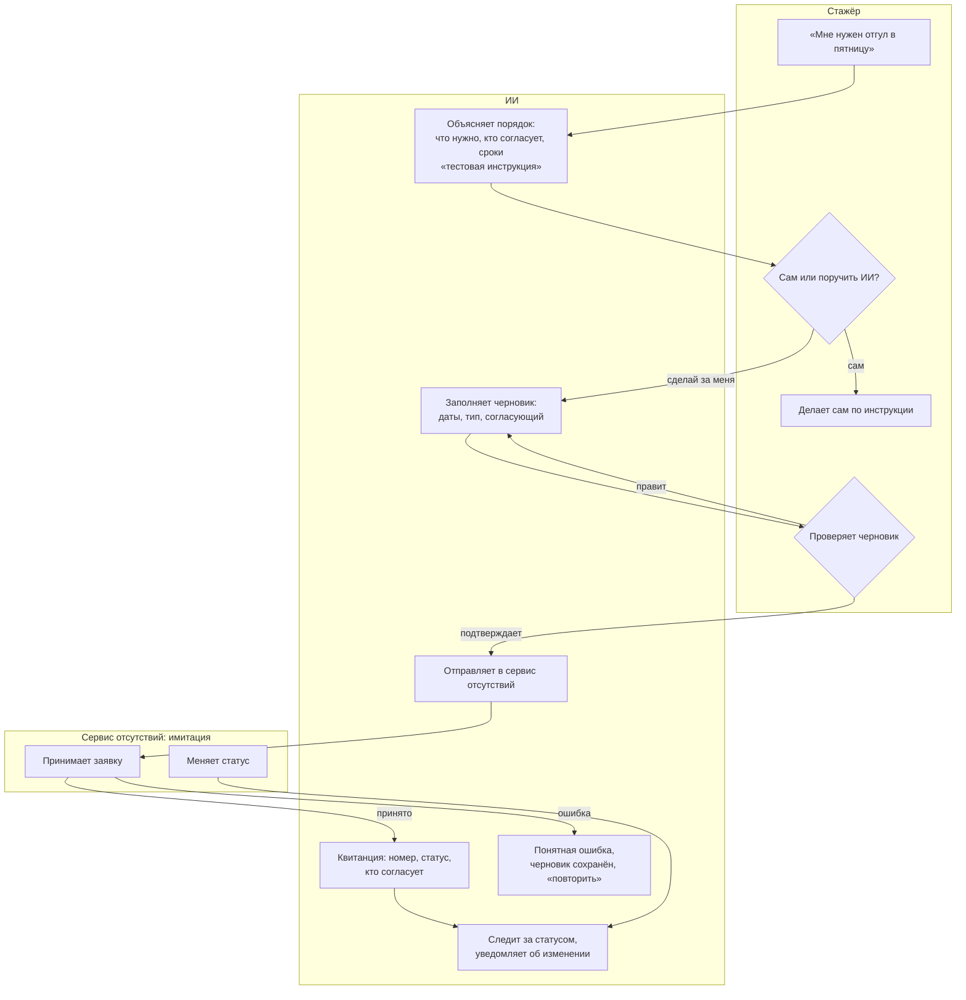
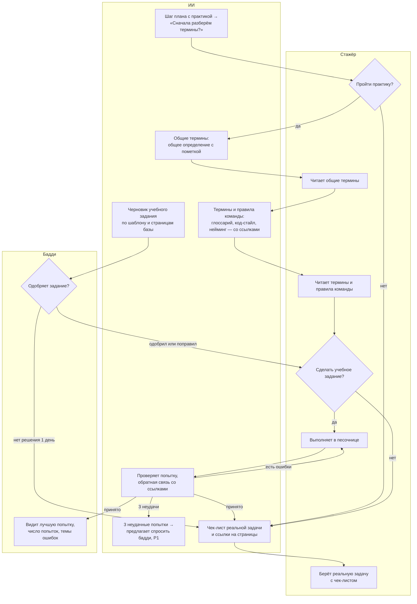
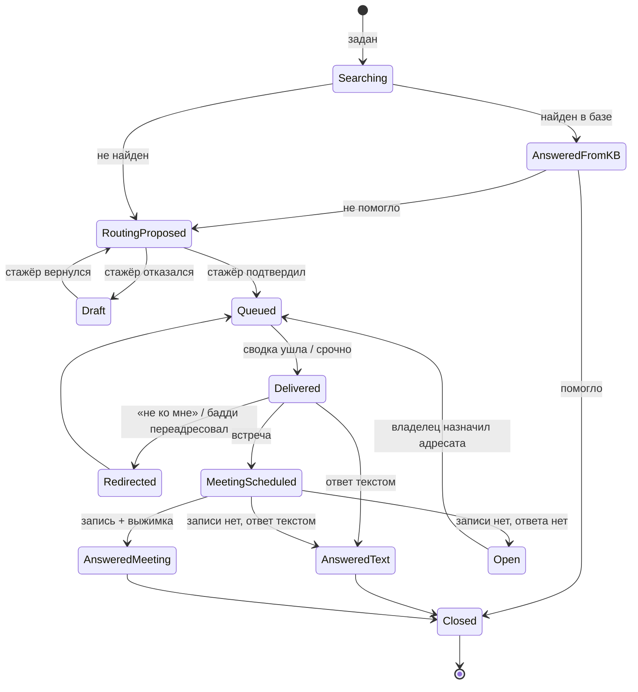

# 03. Процессы

> Нотация: схемы в Mermaid с дорожками-ролями (аналог пулов и дорожек BPMN), рендерятся прямо в GitHub. Под каждой схемой — шаги и исключения. Правила, на которые ссылаются шаги, — в [04-BUSINESS-RULES.md](./04-BUSINESS-RULES.md).

| ID | Процесс | Запускается |
|---|---|---|
| P1 | Маршрутизация вопроса | Стажёр задал вопрос |
| P2 | Ответ текстом → страница в базе | Адресат отвечает текстом |
| P3 | Встреча → запись → транскрипт → страница | Адресат выбрал «обсудим на встрече» |
| P4 | План адаптации и ведение стажёра | Стажёр добавлен в команду; каждый рабочий день |
| P5 | Поддержка базы знаний | Постоянно; плановая проверка раз в 4 месяца |
| P6 | Заявка через сервис (отгул, отпуск, доступ) | Стажёр просит отгул, отпуск или доступ; шаг плана типа «доступ» |
| P7 | Практика перед задачей | Подошёл шаг плана, у которого есть сценарий практики |

---

## P1. Маршрутизация вопроса

**Шаги**

| # | Кто | Шаг | Правила |
|---|---|---|---|
| 1 | Стажёр | Задаёт вопрос через маскота или со страницы «Вопросы» | — |
| 2 | ИИ | Ищет ответ только в пространствах, доступных стажёру | BR-40 |
| 3 | ИИ | Нашёл → отвечает со ссылкой на источник, датой и автором | BR-01, BR-02 |
| 4 | Стажёр | Отмечает «помогло» / «не помогло, устарело». «Не помогло» запускает поиск человека | BR-03 |
| 5 | ИИ | Не нашёл → честно говорит об этом и ищет эксперта | BR-04, BR-10 |
| 6 | ИИ | Эксперт определён → называет его и **причину выбора** («автор 3 страниц о витринах DWH») | BR-12 |
| 7 | ИИ | Эксперт не определён → предлагает отправить бадди | BR-13 |
| 8 | Стажёр | Подтверждает отправку. Без подтверждения ничего не уходит | BR-11 |
| 9 | ИИ | При необходимости задаёт уточняющие вопросы; формулирует вопрос: суть, контекст, что уже пробовал, ссылки | BR-14 |
| 10 | ИИ | Стажёр может пометить «срочно, блокирует работу» → уходит сразу с пометкой; иначе — в сводку получателя | BR-20…BR-24 |
| 11 | Бадди | Видит маршрут: кому, тема, статус. Может переадресовать | BR-15, BR-16 |
| 12 | Адресат | Отвечает текстом (P2), выбирает встречу (P3) или «не ко мне» | BR-17 |

**Исключения**

| Ситуация | Что происходит |
|---|---|
| Адресат нажал «не ко мне» | ИИ предлагает следующего кандидата; если кандидатов нет — бадди. Стажёр видит, что вопрос переадресован |
| Адресат не ответил за SLA | Напоминание адресату; ещё через SLA — уведомление бадди с предложением переадресовать (BR-18) |
| Вопрос про оценку, выход в штат, конфликт | ИИ не отвечает по существу, предлагает обсудить с бадди или руководителем (BR-60) |
| LLM не отвечает | Статус «думаю…», через таймаут — понятная ошибка и «повторить»; вопрос не теряется (BR-70) |
| Ответ из базы найден в чужом пространстве | Не показывается; для стажёра ответа «нет» (BR-40) |

---

## P2. Ответ текстом → страница в базе

**Шаги и правила**

1. Ответ сразу уходит стажёру — он не ждёт публикации страницы.
2. Даже короткий ответ («да, в пятницу релиза нет») оформляется страницей типа «Вопрос-ответ» (BR-31).
3. ИИ раскладывает страницу по папке и проверяет похожие. Если похожая есть — предлагает дополнить её, а не создавать новую (BR-32).
4. Автор ответа получает: «Проверь, я занёс твой ответ в базу» со ссылкой на черновик. Публикация только после «Ок» (BR-30).
5. Автор не подтвердил за 3 рабочих дня → одно напоминание; ещё через 3 дня черновик уходит владельцу базы в «Поддержку базы» (BR-33).
6. В странице указаны: автор ответа (человек, не ИИ), дата, исходный вопрос, ссылка на запись встречи, если была.

---

## P3. Встреча → запись → транскрипт → страница

**Шаги и правила**

1. Слоты — только в рабочие часы обоих участников; встреча создаётся после подтверждения адресата (BR-41).
2. В описании встречи — сформулированный вопрос стажёра и пометка «встречу нужно записать для базы знаний».
3. Запись включает человек (организатор). ИИ напоминает за 5 минут до начала и в момент начала (BR-35).
4. После встречи:
   - **запись и транскрипт есть** → ИИ выделяет ответ на исходный вопрос, а не пересказывает всю встречу, ставит таймкоды, готовит черновик страницы со ссылкой на запись → автор подтверждает (BR-30, BR-36);
   - **записи нет** → ИИ один раз предлагает адресату: «Записи нет. Сформируем ответ текстом?» «Да» → P2. «Нет» → вопрос попадает в «Открытые вопросы» поддержки базы (BR-37).
5. В MVP запись и транскрипт — заглушки; интерфейс адаптера ВКС готов к подключению.

---

## P4. План адаптации и ведение стажёра

**Шаги и правила**

1. Шаблон плана — данные отдела (этапы и шаги по неделям, на основе чек-листа Авито); суть не зависит от отдела (BR-80).
2. ИИ готовит черновик → бадди правит → руководитель утверждает. Нет решения 2 рабочих дня → план активируется по шаблону с пометкой «не утверждён», руководитель получает напоминание (BR-81).
3. Шаг плана = подзадача эпика адаптации в Jira (в MVP — заглушка). Прогресс читается из статусов, отдельной базы прогресса нет (BR-82).
4. Режимы проактивности стажёра: «план на день» (по умолчанию), «только дедлайны и встречи», «выкл» (BR-83).
5. **Знакомство с командой:** ИИ показывает, кто за что отвечает, со ссылками на страницы и профили, и предлагает: «Напиши Михаилу, вот черновик». Сам коллегам не пишет (BR-62).
6. Напоминания: утренний дайджест, за день и за час до события, риск по дедлайну. Только в рабочие часы (BR-84).
7. Нет активности 2 рабочих дня → мягкий сигнал бадди «простаивает» (BR-85).

---

## P5. Поддержка базы знаний

**Шаги и правила**

1. Каждая страница лежит в папке. Папки — данные отдела, ИИ предлагает папку, автор может поменять (BR-32).
2. «Поддержка базы» — постоянно доступный список у владельца: открытые вопросы (не ответили, записи нет), черновики без подтверждения (BR-33, BR-37).
3. Раз в 4 месяца ИИ-крон ищет дубли: похожие вопросы с ответами разными словами. Готовит объединённый текст и отправляет владельцу сводку (BR-38).
4. Объединение — только после подтверждения владельца. Старые страницы не удаляются, а ведут на новую. Авторы получают уведомление (BR-39).
5. Пара, помеченная «не дубль», больше не предлагается.
6. Открытый вопрос владелец может назначить конкретному человеку — дальше по P1 с шага 10.

---

## P6. Заявка через сервис (отгул, отпуск, доступ)

**Шаги и правила**

1. ИИ объясняет порядок со ссылкой на тестовую инструкцию с пометкой «не регламент Авито» (BR-05).
2. Два пути: «сделай сам» (шаги и ссылка на сервис) или «сделаю за тебя» (BR-42).
3. Действие выполняется только по лестнице доверия: черновик → подтверждение → выполнение → квитанция (BR-43).
4. Действие выполнено, когда сервис вернул результат, а AI-buddy его показал и сохранил (требование кейса).
5. Квитанция видна стажёру в чате и в ленте; руководитель видит статус в ленте прогресса.
6. Типы заявок MVP: отгул; отпуск и больничный — по тому же процессу через тот же сервис-заглушку. Финансовые поля не заполняются (BR-61).
7. **Свою систему заявок не делаем.** У Авито сервисы отсутствий и доступов уже есть; AI-buddy только формирует заявку и отправляет её через адаптер в существующий сервис, затем читает статус (BR-74). В MVP вместо сервисов — заглушки `absence-service.json` и `access-service.json`.
8. Типы заявок в MVP: **отгул, отпуск, доступ.** Доступ — по тому же процессу через сервис доступов (US-31). Если доступ по плану ещё не положен или нужен вне шага плана, ИИ объясняет, когда его выдают и кто согласует, не раскрывая закрытых данных (BR-45).

---

## P7. Практика перед задачей

> Из фидбека Авито: частые боли стажёров — незнание код-стайла, архитектуры и жаргона команды; полезна практика до реальной задачи. Демо на шаге s-13 «Первая задача: собери дашборд конверсии карточки объявления».

**Шаги и правила**

1. Сценарий практики — данные шаблона плана: какие термины, какие страницы, какое учебное задание и критерии проверки (BR-80, BR-87). В MVP один сквозной сценарий для аналитика.
2. ИИ предлагает практику, когда шаг попадает в «шаги на сегодня». Практика необязательна, любой шаг можно пропустить (BR-100, BR-101).
3. **Общие термины** (конверсия, воронка, дашборд) ИИ объясняет с пометкой «общее определение». **Термины команды** (ads_mart, «карточка», «песочница») и правила (код-стайл SQL, нейминг таблиц и графиков) — только из базы со ссылкой на страницу (BR-01, BR-88).
4. Учебное задание ИИ готовит заранее, когда шаг появился в плане, и отправляет бадди на одобрение. Без одобрения за 1 рабочий день стажёр проходит практику без задания (BR-102).
5. Задание выполняется в песочнице на синтетических данных (BR-103). ИИ проверяет попытку по критериям и объясняет ошибки со ссылками на страницы, но не решает реальную задачу (BR-104).
6. Бадди видит лучшую попытку, число попыток и темы ошибок, без черновиков и диалога (BR-105). После 3 неудачных попыток ИИ предлагает спросить бадди по P1 (BR-106).
7. Переход к реальной задаче: чек-лист по критериям готовности из шаблона и ссылки на страницы, которые понадобятся.
8. **Для другой роли** суть та же, меняется набор знаний: у бэкенда — карта сервисов, код-стайл языка, линтеры, частые замечания ревью (BR-87).

---

## Модели статусов

### Вопрос

| Статус | Что видит стажёр |
|---|---|
| Searching | «Ищу в базе…» |
| AnsweredFromKB | Ответ с источником, кнопки «помогло» / «не помогло» |
| RoutingProposed | «Не нашёл. Могу спросить {имя} — {причина}» |
| Draft | Вопрос сохранён, можно вернуться |
| Queued | «Отправлю {имя} в ближайшей сводке, ~{время}» или «Отправлено срочно» |
| Delivered | «{Имя} получил вопрос» |
| Redirected | «Вопрос переадресован {имя}» |
| MeetingScheduled | Встреча с датой и ссылкой |
| AnsweredText / AnsweredMeeting | Ответ, ссылка на страницу базы |
| Open | «Ответа пока нет, вопрос передан владельцу базы» |
| Closed | В истории |

### Страница базы знаний

`Draft` (черновик ИИ) → `OnReview` (у автора ответа) → `Published` → `Merged` (влита в другую, ведёт на неё) или `Archived`.

### Шаг плана

`Planned` → `Today` (в шагах на сегодня) → `Done` | `Overdue` → `Done`. Пропущенный шаг утром переносится в `Today` с вопросом «нужна помощь?».

### Учебное задание

`Draft` (сгенерировано ИИ) → `Approved` (бадди одобрил или поправил) | `Skipped` (нет решения 1 рабочий день) → `InProgress` → `Passed` | `Failed` (3 неудачные попытки → вопрос бадди по P1). Стажёр может перевести задание в `Skipped` на любом шаге.

### Заявка

`Draft` → `Confirmed` → `Sent` → `Accepted` | `Rejected` | `Error` → (`Error` → `Sent` по «повторить»).
