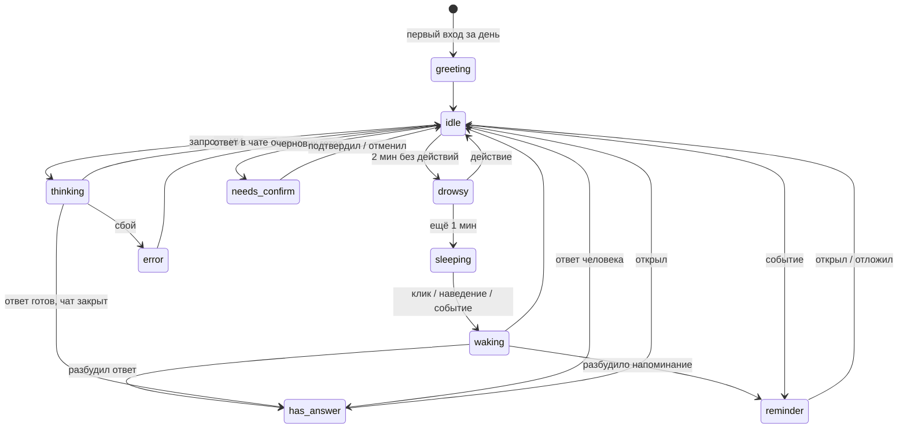

# 08. Требования к дизайну

> Что должен решить дизайн: маскот, который помогает и не раздражает; интерфейсы ролей, где сразу видно главное; тон, в котором не стыдно спрашивать.
> Технические требования к виджету — [07-FRONTEND.md](./07-FRONTEND.md), правила поведения — BR-90…BR-93 в [04-BUSINESS-RULES.md](./04-BUSINESS-RULES.md).

## 1. Принципы

1. **Помогает по поводу, а не ради внимания.** Урок Скрепыша (Clippy): проактивная подсказка должна заслужить право перебить. Маскот реагирует только на события из BR-90.
2. **Главное видно за 3 секунды.** У стажёра — что сделать сегодня; у бадди — где застрял стажёр; у эксперта — что ждёт ответа; у руководителя — кто отстаёт.
3. **Доверие видно.** Источник, автор и дата у ответа; причина выбора адресата; квитанция после действия.
4. **Не стыдно спросить.** Дружелюбный тон, никаких «вы уже спрашивали».
5. **Визуальная логика дизайн-системы Авито:** именованные токены цветов и текста, единые компоненты, обязательная проверка в светлой и тёмной теме.

## 2. Маскот

### 2.1 Персонаж и права
- Синий зверёк из материалов Авито. **Официальный исходник, название и разрешение на использование уточнить у кураторов трека.** До получения — нейтральная заглушка того же размера.
- Не перерисовывать персонажа самостоятельно и не менять его облик без согласования.
- Нужны кадры или анимации для каждого состояния из 2.2 на прозрачном фоне, в двух размерах: 96 px и 32 px.

### 2.2 Состояния

| Состояние | Когда (триггер) | Как выглядит | Длительность / цикл | Текст / бейдж |
|---|---|---|---|---|
| `idle` — спокоен | Нет событий, недавно было взаимодействие | Сидит, изредка моргает, лёгкое «дыхание» | Цикл 4–6 с, моргание раз в 5–8 с | — |
| `drowsy` — дремлет | 2 мин без взаимодействия | Глаза полуприкрыты, медленно кивает | Переходное, 60 с | — |
| `sleeping` — спит | 3 мин без взаимодействия (BR-91) | Глаза закрыты, «zzz» над головой | Медленный цикл 6–8 с | Подсказка при наведении: «Сплю. Нажми, если нужен» |
| `waking` — просыпается | Клик, наведение или событие во сне | Открывает глаза, потягивается | Один раз, ≤ 1 с | — |
| `greeting` — машет | Первое открытие за день; возвращение после сна по клику | Машет лапкой | Один раз, ≤ 1,5 с, не повторяется в течение часа | — |
| `thinking` — думает | Запрос к ИИ в работе | Задумчиво смотрит вверх, «…» в облачке | Цикл, пока идёт запрос | «Думаю…» |
| `has_answer` — пришёл ответ | Ответ человека или ИИ готов | Радуется, держит конверт | Короткая реакция ≤ 1,5 с, далее статичный кадр с бейджем | Бейдж-счётчик, подсказка «Ответ готов» |
| `reminder` — напоминание | Событие скоро, дедлайн под угрозой, новый шаг плана | Поднимает табличку или часы | Короткая реакция, далее статичный кадр с бейджем | Бейдж «15:00 · 1:1» |
| `needs_confirm` — ждёт подтверждения | Черновик вопроса или заявки ждёт стажёра | Держит листок | Статичный кадр | Бейдж «1 черновик» |
| `error` — что-то пошло не так | Ошибка LLM или сервиса | Растерян, разводит лапами | Короткая реакция, затем `idle` с бейджем | «Не получилось. Повторить?» |
| `minimized` — свёрнут | Пользователь свернул | Точка 32 px с цветным индикатором события | — | Индикатор, если есть событие |

### 2.3 Переходы

**Приоритет при нескольких событиях:** `error` → `has_answer` → `needs_confirm` → `reminder`. Бейдж показывает общее число.

### 2.4 Чего маскот не делает
- Не говорит без повода, не даёт «советов дня».
- Не прыгает и не машет повторно, если пользователь не отреагировал: одна короткая реакция, дальше статичный бейдж.
- Не перекрывает элементы интерфейса, не появляется по центру экрана.
- Не издаёт звуков в MVP.
- Не показывает содержимое ответа в облачке — только факт («Ответ готов»).

### 2.5 Взаимодействие
- Клик — открыть или закрыть чат.
- Наведение — подсказка с ближайшим событием или «Ответ готов».
- Перетаскивание — в любое место у края экрана; при отпускании «прилипает» к ближайшему краю.
- Меню по правому клику или долгому нажатию: «Свернуть», «Скрыть на час», «Настройки».

### 2.6 Доступность
- Каждое состояние дублируется бейджем или текстом; смысл не передаётся только цветом и анимацией.
- `prefers-reduced-motion` или выключенные анимации → статичные кадры для каждого состояния.
- Виджет доступен с клавиатуры (Tab, Enter открывает чат), у него есть подпись для скринридера с текущим состоянием («AI-buddy: ответ готов»).

### 2.7 Как это делают другие (референсы)
- Десктопные питомцы обычно строятся на наборе состояний: покой, ходьба, работа, «думаю», сон и разговор, когда персонаж поворачивается к пользователю с облачком ([mu pet](https://www.skillsdirectory.com/skills/modbender-mu-pet)).
- Засыпание через время бездействия и пробуждение по клику — распространённый приём ([Desktop Dragon Pet](https://themrfoxman.itch.io/desktop-dragon-pet)).
- Хорошо принятые питомцы сдержанны: взаимодействие необязательное и короткое, не требует постоянного внимания ([обзор](https://analytics.streetsforall.org/insights/desktop-pet-revolution-why-this-mini-furry-friend-is-taking-over-your-screen-3223668)).
- Скрепыш (Clippy) — антипример: перебивал в неудачный момент непрошеными подсказками ([bad.technology](https://bad.technology/articles/microsoft-clippy-becomes-the-most-despised-software-feature-in-history.html)).

## 3. Интерфейсы ролей

| Роль | Что главное на первом экране | Акцент |
|---|---|---|
| Стажёр | Шаги на сегодня и ближайшее событие | Спокойный, дружелюбный, маскот |
| Бадди | Где стажёр застрял, срочные вопросы | Сигналы и статусы, минимум текста |
| Эксперт | Что ждёт ответа и до какого срока | Карточка вопроса с контекстом и тремя действиями |
| Руководитель | Кто отстаёт, нагрузка бадди, поддержка базы | Таблицы и цифры |

**Обязательные компоненты дизайн-системы проекта:** карточка ответа с источником, карточка предложения адресата с причиной, черновик вопроса, черновик действия и квитанция, статус-бейджи вопроса (по модели статусов из 03-PROCESSES), пометка «Срочно», бейдж «Тестовая инструкция», карточка человека, шаг плана, прогресс этапа, сравнение дублей.

**Цвета статусов:** нейтральный — ожидание, синий — в работе, зелёный — готово, жёлтый — требует внимания, красный — срочно или ошибка. Всегда с текстом.

## 4. Тон общения

### Принципы
- С стажёром на «ты», коротко и по-дружески, без канцелярита и без сюсюканья.
- С экспертами и руководителем в системных сообщениях — на «вы», уважительно к их времени: сразу суть.
- Не оценивать вопросы («хороший вопрос!», «это же просто»).
- Честно говорить «не знаю» и предлагать следующий шаг.
- Эмодзи — не больше одного на сообщение и только в сообщениях стажёру.

### Примеры

| Ситуация | Так | Не так |
|---|---|---|
| Ответ из базы | «Витрина объявлений лежит в DWH, схема `ads_mart`. Источник: страница Михаила Орлова „Витрины DWH“, обновлена 12 октября.» | «Отличный вопрос! Согласно имеющейся документации…» |
| Не нашёл | «В базе не нашёл. Михаил Орлов написал три страницы о витринах — похоже, он знает. Сформулировать вопрос ему?» | «Ошибка: информация не найдена.» |
| Уточнение | «Чтобы Михаилу было проще: за какой период сравнивал и в каком дашборде?» | «Пожалуйста, предоставьте дополнительную информацию.» |
| Отправлено | «Отправлю Михаилу в 16:00 вместе с другими вопросами. Срочно — нажми „Срочно“.» | «Ваш запрос поставлен в очередь.» |
| Эксперту | «Даниил Соколов (стажёр) спрашивает, почему конверсия в дашборде расходится с DWH. Вам — как автору страниц о витринах. Ответить, назначить встречу или „не ко мне“.» | «Новое сообщение от AI-buddy.» |
| Черновик страницы | «Занёс ваш ответ в базу как черновик. Проверьте, пожалуйста: „Ок“ — опубликую.» | «Подтвердите публикацию материала.» |
| Записи нет | «Записи встречи нет. Сформируем ответ текстом? Займёт пару минут.» | «Запись не обнаружена. Процесс прерван.» |
| Граница | «Про выход в штат лучше поговорить с Екатериной или Андреем — это решают они. Помочь договориться о встрече?» | «Я не могу ответить на этот вопрос.» |
| Нет прав | «Это пространство тебе пока недоступно. Могу подготовить запрос доступа Андрею.» | «Доступ запрещён.» |
| Ошибка | «Не получилось связаться с сервисом отсутствий. Черновик сохранил — попробуем ещё раз?» | «Error 503.» |

### Уведомления в Telegram
Только факт и ссылка, без содержания (BR-51):
- «Михаил Орлов ответил на твой вопрос. Открыть →»
- «Через час 1:1 с Екатериной. Открыть →»
- «Новый срочный вопрос от Даниила Соколова. Открыть →»
- «Запишите встречу: начинается через 5 минут. Открыть →»

## 5. Что отдать в разработку от дизайна

- Макеты экранов SCR-I1…SCR-L3 в светлой и тёмной теме.
- Набор компонентов из раздела 3 со всеми состояниями.
- Кадры или анимации маскота для всех состояний из 2.2 в 96 px и 32 px + статичные кадры для reduced motion.
- Тексты интерфейса и шаблоны сообщений по разделу 4.
