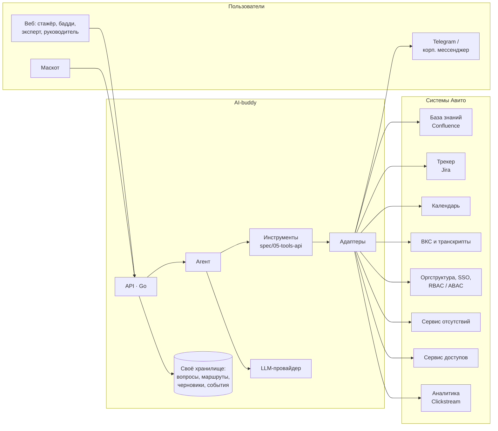

# 11. Интеграция с системами Авито

> **Почему интеграция простая.** AI-buddy — отдельный сервис. Он не дублирует то, что уже хранится в системах Авито, а обращается к ним через адаптеры с единым интерфейсом. Подключить реальную систему — значит реализовать один адаптер и прописать конфиг. Логика агента, процессы и интерфейсы ролей при этом не меняются (BR-74).

## 1. Принципы

| Принцип | Что это значит | Правило |
|---|---|---|
| Источник правды остаётся в Авито | База знаний, трекер, календарь, заявки и оргструктура живут в своих системах. У AI-buddy хранятся только вопросы, маршруты, черновики и события | A1 |
| Права наследуются, а не копируются | Запрос в систему идёт от имени пользователя, и система сама отдаёт только доступное ему. Своей копии прав нет | BR-40, A8 |
| Пишем только после подтверждения | Страница, статус шага, встреча, заявка создаются после «Ок» человека | BR-43 |
| Отдел подключается данными, а не кодом | Шаблон плана, папки базы, пороги и уровни руководства — конфиг отдела | A4, BR-80, BR-10a |
| LLM заменяемая | Провайдер выбирается переменными окружения; можно подключить внутреннюю модель Авито через OpenAI-совместимый API | A6, BR-72 |
| Сбой системы не ломает продукт | Неблокирующие вызовы, таймаут, понятная ошибка, запрос не теряется | BR-53, BR-70 |

## 2. Схема



## 3. Точки интеграции

| Система | Читаем | Пишем (после подтверждения) | Адаптер | В Авито (предположение) | В MVP |
|---|---|---|---|---|---|
| База знаний | Страницы, авторы и правки, пространства с учётом прав | Черновик и публикация «Вопрос-ответ», объединение дублей | `KnowledgeBase` | Confluence REST API | [kb-pages.json](../04-mock-data/kb-pages.json) |
| Трекер | Эпик адаптации, шаги, статусы | Статус шага, отметка «первая полезная задача» | `Tracker` | Jira REST API | [tracker.json](../04-mock-data/tracker.json) |
| Оргструктура | Сотрудники, отдел, должность, зона ответственности, уровень руководства, бадди | — | `Directory` | HR-система, LDAP | [team.json](../04-mock-data/team.json) |
| Авторизация | Пользователь, роли (RBAC), атрибуты (ABAC) | — | `Auth` | Корпоративный SSO (OIDC) | Тестовые учётки, заголовок `X-User` |
| Календарь | События, свободные слоты | Встреча после согласия адресата | `Calendar` | Корпоративный календарь | [calendar.json](../04-mock-data/calendar.json) |
| ВКС | Запись и транскрипт встречи | — | `Meetings` | Внутренняя ВКС и распознавание речи | [meetings.json](../04-mock-data/meetings.json), транскрипты |
| Сервис отсутствий | Правила, предпроверки | Заявка на отгул, отпуск | `Absence` | Существующий сервис заявок | [absence-service.json](../04-mock-data/absence-service.json) |
| Сервис доступов | Каталог систем, статусы доступов | Заявка на доступ | `Access` | Существующий сервис доступов | [access-service.json](../04-mock-data/access-service.json) |
| Уведомления | — | Уведомление без содержания со ссылкой | `Notifier` | Telegram или корпоративный мессенджер | [notifications.json](../04-mock-data/notifications.json) |
| Аналитика | — | События для метрик | `Events` | Clickstream | Лог событий |

## 4. Контракт адаптера

Общие правила для всех адаптеров:
- каждый метод получает пользователя, от имени которого идёт запрос, — права проверяет сама система;
- ошибки приводятся к единым кодам `forbidden`, `not_found`, `validation`, `unavailable` (как в [spec/05-tools-api.md](../spec/05-tools-api.md#формат-результата));
- у каждого вызова таймаут; ответ системы не блокирует интерфейс (BR-70);
- у каждого адаптера есть mock-реализация на данных `docs/04-mock-data` — на ней работают демо и тесты.

```go
type KnowledgeBase interface {
    Search(ctx context.Context, u User, query string) ([]Page, error)
    Get(ctx context.Context, u User, id string) (Page, error)
    AuthorSignals(ctx context.Context, u User, topic string) ([]AuthorSignal, error) // для выбора эксперта, BR-10
    CreateDraft(ctx context.Context, u User, d PageDraft) (string, error)
    Publish(ctx context.Context, u User, id string) error
}

type Tracker interface {
    Plan(ctx context.Context, u User, internID string) (Plan, error)
    SetStepStatus(ctx context.Context, u User, stepID string, s StepStatus) error
}

type Directory interface {
    Team(ctx context.Context, u User) ([]Person, error) // роль, зона ответственности, уровень руководства, бадди
}

type Calendar interface {
    Events(ctx context.Context, u User, from, to time.Time) ([]Event, error)
    FreeSlots(ctx context.Context, u User, with []string, within time.Duration) ([]Slot, error)
    CreateMeeting(ctx context.Context, u User, m MeetingDraft) (string, error)
}

type Meetings interface {
    Transcript(ctx context.Context, u User, meetingID string) (Transcript, error)
}

type Absence interface {
    Rules(ctx context.Context, u User, kind string) (Rules, error)
    Precheck(ctx context.Context, u User, r AbsenceDraft) ([]Warning, error)
    Create(ctx context.Context, u User, r AbsenceDraft) (Receipt, error)
}

type Access interface {
    Catalog(ctx context.Context, u User) ([]System, error)
    Request(ctx context.Context, u User, system, reason string) (Receipt, error)
}

type Notifier interface {
    Notify(ctx context.Context, to string, n Notification) error // без содержания, BR-51
}
```

## 5. Что уже есть в коде

| Слой | Состояние |
|---|---|
| LLM | Уже за интерфейсом `Provider` (`backend/internal/llm`): Anthropic, OpenAI-совместимый провайдер с настраиваемым `LLM_BASE_URL` и заглушка. Смена модели — переменные окружения |
| Инструменты агента | Агент работает только через инструменты из [spec/05-tools-api.md](../spec/05-tools-api.md). Это граница, за которой стоят источники данных |
| Источники данных | Инструменты читают имитации из `docs/04-mock-data` через `internal/store`. Следующий шаг бэкенда — выделить интерфейсы из раздела 4 в отдельный пакет адаптеров с mock-реализацией на этих же JSON. Для демо это не обязательно |
| Развёртывание | `docker-compose.yml`: приложение и PostgreSQL, можно развернуть внутри контура Авито |

## 6. Порядок подключения в пилоте

Каждый шаг полезен сам по себе, поэтому подключать можно по одной системе.

| Шаг | Что подключаем | Что начинает работать |
|---|---|---|
| 1 | SSO и оргструктура | Реальные пользователи, роли, бадди, уровни руководства |
| 2 | База знаний, только чтение | Ответы из базы с источником, выбор эксперта по авторству |
| 3 | Корпоративный мессенджер для уведомлений | Сводки и срочные вопросы доходят до людей |
| 4 | Трекер | План адаптации и прогресс из реальных задач |
| 5 | База знаний, запись | Ответы людей становятся страницами — киллер-фича работает целиком |
| 6 | Календарь и ВКС | Встречи по вопросам и выжимки из транскриптов |
| 7 | Сервисы отсутствий и доступов | Заявки «сделаю за тебя» |
| 8 | Clickstream | Метрики пилота ([09-METRICS.md](./09-METRICS.md)) |

## 7. Безопасность

- Персональные данные и секреты не передаются в LLM; ключ — через переменную окружения (BR-72).
- В Telegram уходят только уведомления без содержания (BR-51).
- Недоступное пользователю не ищется, не цитируется и не упоминается (BR-40).
- Каждое действие ИИ и людей логируется (BR-73).

## 8. Что нужно от Авито для пилота

1. Доступ к API тестовых пространств базы знаний и трекера; сервисная учётка или OAuth-приложение.
2. Подключение к SSO и список ролей и атрибутов ABAC, включая уровень руководства для BR-10a.
3. API или webhook сервисов отсутствий и доступов.
4. Решение по LLM: внешняя модель или внутренняя через OpenAI-совместимый API.
5. Канал уведомлений: Telegram-бот или корпоративный мессенджер.
